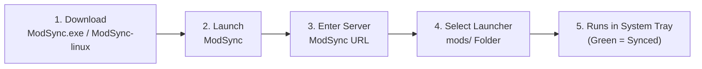

# 🖥️ ModSync Client User Guide

> **Companion To:**
> - [[index|Minecraft Survival Server Guide]]
> - [[modsync_client_architecture|ModSync Client Architecture & Developer Guide]]
>
> **Scope:** Step-by-step player guide for installing, configuring, and using the **ModSync** desktop application to keep your Minecraft `mods/` folder automatically synchronized with the server.

---

## 1. What is ModSync?

**ModSync** is a lightweight background tray application that keeps your Minecraft **Forge 1.20.1** `mods/` folder in sync with our server automatically:
- **Zero manual `.jar` management:** Downloads new mods, updates changed mods, and removes outdated server mods automatically.
- **Instant live updates:** Listens over WebSocket (`wss://`) so your mods update as soon as the server updates.
- **Safe while playing:** If an update arrives while Minecraft is running, ModSync downloads and stages it in the background and waits until you close Minecraft before modifying your `mods/` folder.
- **Optional recommended client mods:** Lets you install curated performance, shader, and QoL mods (Embeddium, Oculus, Distant Horizons, JourneyMap, AppleSkin, etc.) with one click.

---

## 2. Installation & First-Run Setup



### Step 1 — Download ModSync
Download the standalone executable for your operating system from the server's **GitHub Releases** page:
- **Windows:** `ModSync.exe` *(no Python installation required)*
- **Linux:** `ModSync-linux` *(mark executable with `chmod +x ModSync-linux`)*

### Step 2 — Launch & Configure
1. Double-click **`ModSync.exe`** (or run `./ModSync-linux`).
2. **Server URL Prompt:** On first launch, a **"ModSync Setup"** dialog will appear. Enter the server's ModSync URL provided by the server owner (for example, `https://mods.yourdomain.com`).
3. **Select Your `mods` Folder:** Next, a folder picker will open. ModSync automatically detects common launcher directories and pre-selects the first match:
   - **Modrinth App:** `%APPDATA%\ModrinthApp\profiles\<Profile>\mods`
   - **Prism Launcher / MultiMC:** `%APPDATA%\PrismLauncher\instances\<Instance>\.minecraft\mods`
   - **CurseForge:** `~/curseforge/minecraft/Instances/<Instance>/mods`
   - **Official Minecraft Launcher:** `%APPDATA%\.minecraft\mods`

> [!tip] Make Sure Your Launcher Profile Uses Forge 1.20.1
> Before launching Minecraft, ensure your launcher profile/instance is configured for **Minecraft 1.20.1** with **Forge**. ModSync synchronizes the `.jar` files inside that profile's `mods/` folder.

---

## 3. Using the System Tray Icon

Once configured, ModSync runs quietly in your OS system tray (bottom-right corner of the Windows taskbar next to the clock, or top panel on Linux).

### 3.1 Status Colors

| Badge Color | Status | Meaning |
| :--- | :--- | :--- |
| **Gray** | `Idle` | Starting up and initializing |
| **Blue** | `Syncing` | Checking manifest or downloading mod updates |
| **Green** | `Synced` | All mandatory `server-client` mods are up to date; listening for instant server updates |
| **Amber** | `Staged (Waiting for Minecraft)` | An update was downloaded while Minecraft is open; it will be applied automatically as soon as you close the game |
| **Red** | `Error` | Could not reach the server or verify a download (ModSync retries automatically in the background) |

### 3.2 Right-Click Tray Menu

Right-click the **ModSync** tray icon at any time to access:

- **`Status: ...`** — Displays the current sync state and mod count.
- **`Sync Now`** — Immediately checks the server and synchronizes all mandatory `server-client` mods.
- **`Install Recommended Client Mods`** — Downloads and installs the server's curated `client-only` mod bundle (performance, shaders, minimap, and UI helpers).
- **`Open Mods Folder`** — Opens your configured `mods/` directory in File Explorer / your system file manager.
- **`Configure...`** — Re-opens the setup dialogs to change the Server URL or switch to a different launcher profile's `mods/` folder.
- **`Start with Windows`** *(Windows only)* — Toggles automatic startup when you log in to Windows.
- **`Quit`** — Stops background synchronization and exits ModSync.

---

## 4. Mandatory vs. Recommended Client Mods

ModSync separates mods into two categories:

1. **Mandatory Mods (`server-client`):**  
   Content mods required by both the server and your client (such as [[create|Create]], [[botania|Botania]], [[farmers-delight|Farmer's Delight]], [[twilight-forest-progression|The Twilight Forest]], [[passive-skill-tree|Passive Skill Tree]], and [[fcm-clans|FCM Clans]]). ModSync keeps these synchronized **automatically**.
2. **Recommended Client Mods (`client-only`):**  
   Optional visual, performance, and quality-of-life mods (such as **Embeddium**, **Oculus**, **Distant Horizons**, [[journeymap|JourneyMap]], **AppleSkin**, **Mouse Tweaks**, **Controlling**, and **Better Ping Display**).
   - Click **`Install Recommended Client Mods`** in the tray menu whenever you want to install or update them.
   - Once installed, regular automatic syncs will preserve your `client-only` mods.

> [!note] Custom Personal Client Mods
> ModSync tracks server-managed `.jar` files (and replaces any duplicate Forge `modId` versions), so outdated or removed server mods are cleaned up automatically while your own personal client-only `.jar` mods remain untouched.

---

## 5. Advanced: CLI & Headless Usage

If you run ModSync from a terminal or on Linux without a system tray, you can use its command-line flags:

```bash
# Run a single mandatory mod sync and exit
./ModSync-linux --sync-once --server-url https://mods.yourdomain.com --mods-dir /path/to/mods

# Install or update recommended client-only mods and exit
./ModSync-linux --install-recommended

# Run continuously in the background without a system tray icon
./ModSync-linux --headless

# Re-run interactive setup in the terminal
./ModSync-linux --headless --setup
```

### Configuration & Cache Locations
ModSync stores its `config.json` and temporary `staging/` download cache in:
- **Windows:** `%APPDATA%\ModSync\`
- **macOS:** `~/Library/Application Support/ModSync/`
- **Linux:** `~/.config/modsync/`
