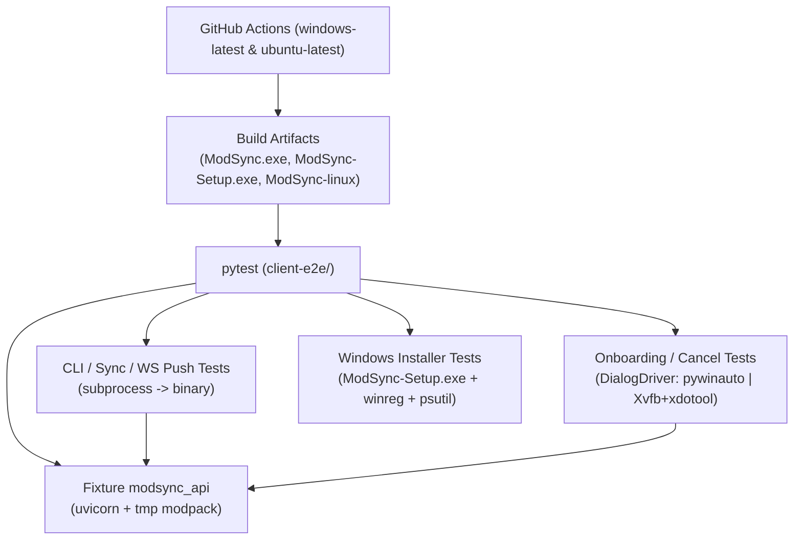

# 🧪 ModSync Client Cross-Platform E2E Testing Plan

> **Companion To:**
> - [[modsync_client_architecture|ModSync Client Architecture & Developer Guide]]
> - [GitHub Issue #9](https://github.com/intelligentRaji/minecraft-server/issues/9)
>
> **Scope:** Implementation plan for the root-level `client-e2e/` automated end-to-end test suite verifying packaged `ModSync` artifacts (`ModSync-Setup.exe` / installed `ModSync.exe` on Windows, `ModSync-linux` on Linux), `modsync_api` integration, `tkinter` onboarding/cancellation, Windows Inno Setup installer/uninstaller lifecycle, and GitHub Actions CI gating across `windows-latest` and `ubuntu-latest`.

---

## 1. Architectural Decisions

### 1.1 Test Stack
- **Orchestrator & Runner:** `pytest` (with `pytest-timeout`), managed as an isolated `uv` project under root-level `client-e2e/`.
- **Live Server Harness:** In-test `uvicorn` subprocess running `modsync_api.app.main:app` on an ephemeral `127.0.0.1` port against a `tmp_path` fixture modpack directory (`server-client/` and `client-only/`) and ephemeral auth tokens.
- **GUI Automation (`tkinter` + native Win32 dialogs):**
  - **Windows (`windows-latest`):** `pywinauto` (`uia` / `win32` backend) for deterministic title-based window lookup, text entry, button clicks, and `WM_CLOSE` cancellation across both `simpledialog` and native Win32 `messagebox` / `filedialog` dialogs.
  - **Linux (`ubuntu-latest`):** `Xvfb` + `xdotool` (via a shared `DialogDriver` abstraction) to drive X11 `tkinter` dialogs headlessly.
- **Windows Installer/Uninstaller Checks:** Python `subprocess` + `winreg` + `psutil` driving Inno Setup silent CLI flags (`/VERYSILENT /SUPPRESSMSGBOXES`).

### 1.2 Why Root-Level `client-e2e/`?
- Keeps `client/`'s `uv` environment strictly scoped to runtime + PyInstaller build dependencies (preventing `pywinauto` or `uvicorn`/`fastapi` from ever entering `ModSync.exe` via `client/modsync.spec`).
- Keeps `make test` (`client/tests/` and `modsync_api/tests/`) fast while giving cross-component E2E tests a clean home alongside `client/` and `modsync_api/`.
- Maps cleanly into `pyrightconfig.json` and `uv --directory client-e2e run pytest -v`.



---

## 2. Target Directory Layout

```text
client-e2e/
├── pyproject.toml              # Standalone uv project (pytest, pytest-timeout, httpx, psutil, uvicorn, fastapi, pywinauto;win32)
├── uv.lock
├── conftest.py                 # Binary/installer path resolution, ModSyncApiServer fixture, DialogDriver fixture, cleanup hooks
├── helpers/
│   ├── __init__.py
│   ├── api_server.py           # Ephemeral modpack generator (valid dummy .jar files) + uvicorn process lifecycle + /health wait
│   ├── dialog_driver.py        # Unified DialogDriver interface -> Windows pywinauto & Linux Xvfb/xdotool backends
│   └── polling.py              # wait_until() deadline polling helpers for async WS sync & Windows uninstaller cleanup
├── test_cli_sync.py            # Windows & Linux: --sync-once, --install-recommended, modsync:// URI, --headless WS push, auth
├── test_onboarding.py          # Windows & Linux: GUI setup flow, invalid invite retry, cancel at every step (exit code 0)
└── test_installer_win.py       # Windows only: silent install, HKCU protocol/autostart, running-process lock, silent uninstall
```

---

## 3. Prerequisites & Product Fixes Identified Before/During Implementation

Code inspection surfaced four considerations that should be addressed alongside (or immediately before) writing the E2E assertions:

1. **GUI Onboarding Cancellation Exit Code (`client/src/modsync_client/onboarding.py`):**
   - Currently, `setup_gui_or_cli()` raises `SystemExit("Setup cancelled.")` when `prompt_config_gui()` returns `None` and `sys.stdin.isatty()` is false (lines 180–185), which produces **exit code `1`** and prints to stderr.
   - Issue #9 explicitly requires asserting **clean exit code `0`** with no error dialogs or unhandled tracebacks when the user cancels at any onboarding step.
   - **Action:** Introduce a clean cancellation signal (e.g., `SetupCancelled` or `raise SystemExit(0)` for intentional user cancellation vs non-zero exit when `tkinter` itself fails to initialize), and update unit tests in `client/tests/` accordingly.

2. **Inno Setup Cleanup of Updater Leftovers & Startup Scripts (`client/installer.iss` & `client/src/modsync_client/desktop.py`):**
   - `updater.py` can leave `ModSync.exe.old` / `.ModSync.exe.new` alongside `{app}\ModSync.exe`, and `desktop.set_windows_autostart()` writes `%APPDATA%\Microsoft\Windows\Start Menu\Programs\Startup\ModSync.bat`.
   - `client/installer.iss` currently removes the Inno-managed `{app}\ModSync.exe` and `HKCU\...\Run` entry, but does **not** have `[UninstallDelete]` entries for updater leftovers (`.old` / `.new`) or `ModSync.bat` in the user Startup folder.
   - **Action:** Add `[UninstallDelete]` entries in `client/installer.iss` for `{app}\ModSync.exe.old`, `{app}\.ModSync.exe.new`, and `{userstartup}\ModSync.bat` (plus verify how `CloseApplications=yes` interacts with the "uninstall blocked while `ModSync.exe` is running" requirement under `/VERYSILENT`).

3. **Windows `console=False` Subprocess Observability (`client/modsync.spec`):**
   - `ModSync.exe` is compiled with `console=False` (`console=(sys.platform != "win32")`). On Windows, stdout/stderr pipes from `subprocess.run()` will generally be empty.
   - **Action:** All cross-platform E2E assertions for `ModSync.exe` must assert **exit codes, filesystem state (`config.json`, `mods/`, `staging/`), and HTTP/WS requests observed by the test `modsync_api`**, never Windows `stdout` text.

4. **Windows Distribution Shift (`ModSync-Setup.exe` as the sole Windows release asset):**
   - When standalone `ModSync.exe` is removed from GitHub Release uploads in favor of shipping only `ModSync-Setup.exe` on Windows, PyInstaller still builds `client/dist/ModSync.exe` as the intermediate payload packaged inside `installer.iss`.
   - **Action (E2E):** Windows E2E tests should default to deriving the tested binary by silently installing `ModSync-Setup.exe` into an isolated session `/DIR=...` (so CLI/sync/onboarding E2E verify the exact installed `ModSync-Setup.exe` payload), rather than assuming standalone `ModSync.exe` is distributed directly.
   - **Note (`updater.py`):** `client/src/modsync_client/updater.py` (`platform_asset_name`) currently expects a GitHub Release asset named `"ModSync.exe"` for Windows self-updates; update `updater.py` (or release-asset handling) before dropping `ModSync.exe` from `publish-release` in `.github/workflows/release-client.yml`.

---

## 4. Phased Implementation Plan

### Phase 1 — Product Prerequisites & Config Plumbing
- [x] Update `client/src/modsync_client/onboarding.py` so user-cancelled GUI and CLI onboarding exits cleanly with code `0` without error dialogs/tracebacks; add unit tests in `client/tests/test_config.py`.
- [x] Update `client/installer.iss` `[UninstallDelete]` to remove updater leftovers (`ModSync.exe.old`, `.ModSync.exe.new`) and `%APPDATA%\...\Startup\ModSync.bat`, and add `[Code] InitializeUninstall()` to block uninstallation cleanly while `ModSync.exe` is running.
- [x] Update `pyrightconfig.json` to add an `executionEnvironments` entry for `client-e2e`.

### Phase 2 — `client-e2e/` Harness & Fixtures
- [x] Create `client-e2e/pyproject.toml` and `client-e2e/uv.lock`.
- [x] Implement `client-e2e/helpers/api_server.py`:
  - Helper to build valid `.jar` fixture files (ZIP archive with `META-INF/MANIFEST.MF` and `META-INF/mods.toml`) in `tmp_path/modpack/{server-client,client-only,server-only}` and compute expected SHA-256 digests.
  - Subprocess launcher for `uvicorn app.main:app --host 127.0.0.1 --port <free_port>` with `MODPACK_DIR`, `MODSYNC_CLIENT_TOKEN`, `MODSYNC_ADMIN_TOKEN`, and `MODSYNC_WS_PING_INTERVAL=2.0`.
  - Readiness probe polling `GET /health`, plus helpers for `reload()` (`POST /api/reload` with `X-Admin-Token`) and guaranteed teardown on failure.
- [x] Implement `client-e2e/conftest.py`:
  - Resolve `MODSYNC_INSTALLER` (default: `client/dist/ModSync-Setup.exe` on Windows) and `MODSYNC_BIN` (on Linux: `client/dist/ModSync-linux` or `client/dist/ModSync`; on Windows: explicit `MODSYNC_BIN` if set, otherwise extract `ModSync.exe` from `MODSYNC_INSTALLER` silently into a session temp directory and immediately uninstall the extraction copy), failing fast with a clear message if artifacts are missing.
  - Provide isolated per-test `env` (`APPDATA`/`LOCALAPPDATA` or `XDG_CONFIG_HOME`/`HOME` redirected under `tmp_path` so host user configs/Minecraft folders are never touched).
- [x] Implement `client-e2e/helpers/dialog_driver.py`:
  - On **Linux** (`X11DialogDriver`): Start `Xvfb` on an unused display (`:95`–`:124`) when `DISPLAY` is unset, and drive windows using `xdotool`.
  - On **Windows** (`Win32DialogDriver`): Use `ctypes.windll.user32` (`EnumWindows`, `SendInput`, `PostMessageW`, `SendMessageW`) across the process tree PIDs to match `"ModSync Setup"`, `"Invalid Invite Link"`, and `"Select Minecraft folder"` dialogs, fill edit boxes, click `OK`/`Cancel`, or close via `WM_CLOSE`.

### Phase 3 — Binary CLI & Sync E2E (`client-e2e/test_cli_sync.py`)
Runs on **both `windows-latest` and `ubuntu-latest`** against the built PyInstaller binary:
1. **`--version` & clean startup:** Binary executes cleanly outside Python source tree (`cwd=tmp_path`) without missing DLL/hiddenimport errors.
2. **Mandatory sync (`--sync-once`):**
   - Pass `--server-url`, `--token`, `--mods-dir`, `--config`.
   - Assert all `server-client` `.jar`s are downloaded with matching SHA-256, `client-only` `.jar`s are **not** installed, and pre-existing stale `.jar`s in `mods_dir` are pruned.
3. **Recommended optional sync (`--install-recommended`):**
   - Assert `client-only` `.jar`s are installed alongside existing `server-client` `.jar`s without removing mandatory mods.
4. **Invite URI resolution (`modsync://connect?url=...&token=...`):**
   - Run `--sync-once` using a `modsync://` URI generated with the same format as `build_invite_url()`; verify `config.json` persists normalized `server_url` and `client_token` and mods sync.
5. **Auth failure handling:**
   - Wrong `--token` against token-protected `modsync_api` exits non-zero (`1`) without corrupting existing `mods_dir`.
6. **WebSocket live push in `--headless` mode:**
   - Start binary with `--headless` and isolated `--config`/`--mods-dir`.
   - Poll `GET /health` until `connected_clients >= 1` and initial sync completes.
   - Add/update/remove a jar in `tmp_path/modpack/server-client/` and call `POST /api/reload`.
   - Poll `mods_dir` via `wait_until()` to verify live addition, replacement, and stale pruning over WebSocket, then terminate cleanly.

### Phase 4 — Onboarding & Cancellation E2E (`client-e2e/test_onboarding.py`)
Runs on **both `windows-latest` and `ubuntu-latest`** (under `Xvfb` on Linux, desktop session on Windows) against the built binary with isolated `HOME`/`APPDATA` and `--config` pointing to a nonexistent file:
1. **Happy-path GUI onboarding + initial sync:**
   - Launch binary with `--setup --config <tmp_config>` (or no config + no args -> wait for tray/first sync -> terminate cleanly, or test `--setup --sync-once` if supported; note `--setup` runs `resolve_or_setup_config` before `_run_one_shot` in `main.py`).
   - Using `DialogDriver`, enter a valid `modsync://connect?...` invite link in `"ModSync Setup"`, dismiss the info prompt, choose a `tmp_path` Minecraft folder in `"Select Minecraft folder"`, and verify `config.json` is written with resolved `mods/` path and synced mods.
2. **Invalid invite link retry:**
   - Enter an invalid string (e.g., `ftp://bad`), wait for `"Invalid Invite Link"` error dialog, dismiss it, then either enter a valid invite link or cancel.
3. **Cancellation at every onboarding step (exit code `0`, no error dialogs):**
   - Cancel / close at Step 1 (invite prompt `simpledialog`).
   - Cancel / close at Step 2 (`messagebox.showinfo` prompt).
   - Cancel / close at Step 3 (`filedialog.askdirectory`).
   - Assert process exits with code `0`, no `config.json` is created, and no `"Error"`/`"Traceback"` window or unhandled exception occurs.

### Phase 5 — Windows Installer & Uninstaller E2E (`client-e2e/test_installer_win.py`)
Runs on **`windows-latest` only** (`pytest.mark.skipif(sys.platform != "win32", ...)`), testing `ModSync-Setup.exe`:
1. **Isolated environment note:** Inno Setup's `DefaultDirName={localappdata}\Programs\ModSync` resolves `{localappdata}` via Windows shell folders (`SHGetKnownFolderPath`), not just `%LOCALAPPDATA%`. Run against `{localappdata}\Programs\ModSync` (cleaned up at fixture teardown) or pass `/DIR=<tmp_install_dir>` if testing non-default paths, and include at least one test verifying the default install target.
2. **Silent install (`ModSync-Setup.exe /VERYSILENT /SUPPRESSMSGBOXES /NORESTART /TASKS=autostart`):**
   - Assert `{localappdata}\Programs\ModSync\ModSync.exe` and `unins000.exe` exist.
   - Verify `winreg` keys:
     - `HKCU\Software\Classes\modsync` (`URL Protocol` and `shell\open\command` pointing to installed `ModSync.exe "%1"`).
     - `HKCU\Software\Microsoft\Windows\CurrentVersion\Run\ModSync` (when `autostart` task is selected).
3. **Installed `modsync://` protocol & updater/startup leftovers simulation:**
   - Simulate `ModSync.exe.old`, `.ModSync.exe.new`, and `%APPDATA%\...\Startup\ModSync.bat` leftovers to verify uninstaller cleanup.
4. **Uninstall blocked cleanly while `ModSync.exe` is running:**
   - Launch installed `ModSync.exe` (e.g. `--headless` against test server so it stays alive).
   - Invoke `unins000.exe /VERYSILENT /SUPPRESSMSGBOXES` (and ensure any close-apps behavior matches the intended contract) and verify `ModSync.exe` is not left corrupted / uninstall exits non-zero or blocks cleanly while running.
5. **Clean silent uninstall:**
   - Terminate `ModSync.exe`, run `unins000.exe /VERYSILENT /SUPPRESSMSGBOXES`, poll with `wait_until()` for `unins000.exe`'s temp child process to finish, and assert:
     - Install directory (`{localappdata}\Programs\ModSync`) is completely removed (including `ModSync.exe.old` / `.ModSync.exe.new`).
     - Startup script (`ModSync.bat`) is removed.
     - Registry keys (`HKCU\Software\Classes\modsync` and `HKCU\Software\Microsoft\Windows\CurrentVersion\Run\ModSync`) are deleted.

### Phase 6 — CI/CD & Developer Workflow Integration
- [x] **Makefile:** Add `client-e2e` target (`uv --directory client-e2e run pytest -v`) while keeping `make test` fast.
- [x] **`.github/workflows/release-client.yml`:**
  - Add `"client-e2e/**"` and `"modsync_api/**"` to `on.push.paths`.
  - Inside `build-client` (after building `ModSync-Setup.exe` on Windows and `ModSync-linux` on Linux):
    - On `ubuntu-latest`: `sudo apt-get update && sudo apt-get install -y python3-tk xvfb xdotool`.
    - Run `uv sync` and `uv run --no-sync pytest -v` in `client-e2e` with `MODSYNC_INSTALLER=${{ github.workspace }}/client/dist/ModSync-Setup.exe` (Windows) or `MODSYNC_BIN=${{ github.workspace }}/client/dist/ModSync-linux` (Linux).
- [x] **`.github/workflows/ci.yml`:**
  - Keep existing fast unit test job (`test`) untouched.
  - Add a matrix E2E job (`client-e2e` on `ubuntu-latest` + `windows-latest`) that builds the packaged artifacts and runs `client-e2e`.

---

## 5. Verification Plan

After implementation, validate across both platforms:
1. **Unit tests remain green:**
   ```bash
   make test
   ```
2. **Local Linux E2E run:**
   ```bash
   make client-build
   MODSYNC_BIN="$PWD/client/dist/ModSync" uv --directory client-e2e run pytest -v
   ```
3. **CI Matrix Validation (`ubuntu-latest` + `windows-latest`):**
   - Trigger `workflow_dispatch` (with `publish_release: false`) on `.github/workflows/release-client.yml` (or PR to `main`) and verify all CLI/sync, WS push, GUI onboarding/cancel, and Windows installer/uninstaller tests pass on both runners.
