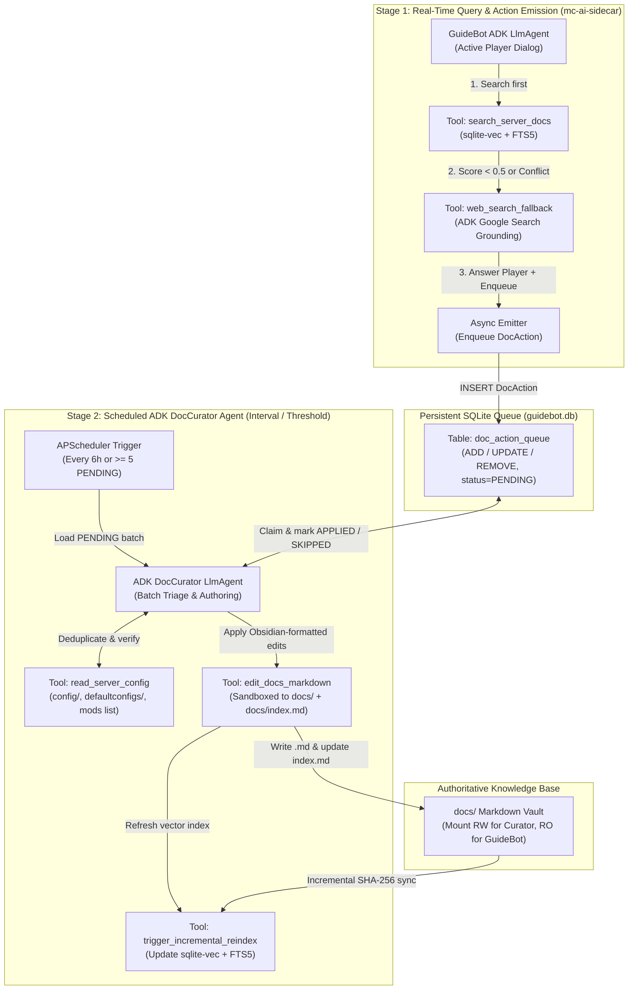
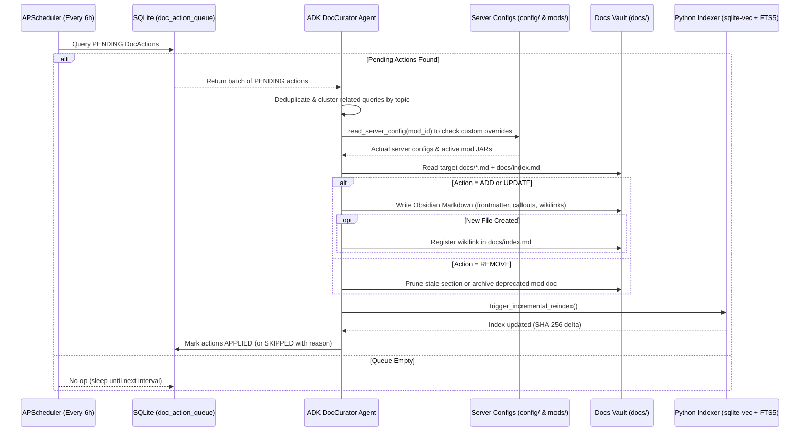

# Technical Design Document: Self-Improving Documentation Curator (`DocCurator`)

> **Companion To:**
> - [minecraft_ai_guide_tdd.md](./minecraft_ai_guide_tdd.md)
> - [minecraft_ai_messaging_and_storage_tdd.md](./minecraft_ai_messaging_and_storage_tdd.md)
>
> **Scope:** Automated gap detection (`ADD` / `UPDATE` / `REMOVE` actions), scheduled Google ADK Curator Agent, server-config cross-verification, Obsidian Markdown authoring, and incremental index refresh  
> **Status:** Approved Architecture (v1)  

---

## 1. Overview & Motivation

### 1.1 The Knowledge Gap Loop
Even with a well-organized [docs/](file:///home/wakaria/dev/minecraft-server/docs/) vault, players inevitably ask questions about:
* **Undocumented mod mechanics** (e.g., an item recipe or boss mechanic not yet covered in `docs/`).
* **Outdated server details** (e.g., a mod version was upgraded or swapped, leaving an old note inaccurate).
* **Deprecated or removed mods** whose pages still pollute RAG retrieval results.

While `GuideBot` falls back to **ADK Google Search Grounding (`Minecraft 1.20.1 Forge`)** in real time to answer the player immediately, answering once on the web shouldn't leave the documentation gap unresolved forever—nor should the next player asking the same question have to trigger another external web search.

### 1.2 Why Two-Stage Asynchronous Curation Instead of Live Edits?
Writing Markdown directly during a player's `/ask` request would add latency, introduce concurrent write races on `docs/`, and risk injecting unverified web defaults over custom server configs. Instead, documentation self-improvement uses a **two-stage asynchronous pipeline**:

1. **Stage 1 (Real-Time Action Emission — Non-Blocking):** When `GuideBot` finds missing, incomplete, or contradicted info while answering a player, it immediately emits a structured **`DocAction`** (`ADD`, `UPDATE`, or `REMOVE`) into `doc_action_queue` inside SQLite (`guidebot.db`). Chat latency remains unaffected.
2. **Stage 2 (Scheduled ADK `DocCurator` Agent — Batch Execution):** On a configurable schedule (e.g., every 6 hours via APScheduler, or immediately when pending actions $\ge 5$), an independent **Google ADK `DocCurator` agent** processes the queue, deduplicates topics, verifies facts against live server configs (`config/`, `defaultconfigs/`), edits `docs/`, updates `docs/index.md`, and triggers an incremental `sqlite-vec` + `FTS5` re-index.

---

## 2. Architecture & Workflow Diagrams

### 2.1 End-to-End Two-Stage Pipeline



### 2.2 Scheduled Curator Execution Sequence



---

## 3. Structured Documentation Action Schema (`DocAction`)

When `GuideBot` detects a documentation gap, staleness, or contradiction, it writes a structured record into `doc_action_queue`:

```json
{
  "id": 42,
  "action_type": "ADD",
  "target_doc_path": "02-dimensions-and-bosses/twilight-forest-progression.md",
  "topic": "Ur-Ghast Carminite Reactor & Tear Strategy",
  "player_query": "How do I charge the ghast traps during the Ur-Ghast fight?",
  "rag_top_score": 0.34,
  "verified_facts": [
    "Lure Carminite Ghastlings near a Ghast Trap and kill them around it to charge the trap.",
    "Once charged with red smoke, activate the trap with a redstone signal or pressure plate to pull the Ur-Ghast down."
  ],
  "source_urls": [
    "https://twilightforest.fandom.com/wiki/Ur-Ghast"
  ],
  "status": "PENDING",
  "created_at": "2026-11-14T20:10:00Z"
}
```

### 3.1 Action Types & Trigger Conditions

| `action_type` | When `GuideBot` Emits It | Curator Behavior |
| :--- | :--- | :--- |
| **`ADD`** | `search_server_docs` returns `rag_top_score < 0.5` and `web_search_fallback` produces verified 1.20.1 Forge facts not covered in `docs/`. | Appends a new `##` section to the relevant category file, or creates a new Markdown note and links it in `docs/index.md`. |
| **`UPDATE`** | A doc exists (`score >= 0.5`), but is missing critical sub-details or disagrees with a newer mod version / player observation. | Updates the existing section in place while preserving existing frontmatter and custom server notes. |
| **`REMOVE`** | A doc references a mod, command, or feature that is no longer installed or enabled on `mc-forge-server`. | Removes the obsolete section (or marks/deletes an entire dead mod guide and removes its `docs/index.md` link). |

---

## 4. Scheduled ADK `DocCurator` Agent Design

The `DocCurator` runs inside the same `mc-ai-sidecar` container as a background scheduler job (`APScheduler`), using its own dedicated Google ADK `LlmAgent` definition and a fresh `InMemoryRunner` per batch run.

### 4.1 Trigger Policy
* **Default Interval:** Every **6 hours** (configurable via `DOC_CURATOR_INTERVAL_HOURS=6`).
* **Threshold Fast-Track:** Also triggers early if `PENDING` rows reach **$\ge 5$** distinct topics (with a minimum 30-minute cooldown between runs).
* **Manual Trigger Endpoint:** `POST /api/v1/curator/run` (secured for admin/RCON/local scripts) to run on demand after installing or upgrading mods.

### 4.2 Curator Processing Steps & Tools
1. **Batch Claim & Deduplication:** Claims all `PENDING` actions (marking them `IN_PROGRESS` so concurrent runs cannot collide) and groups overlapping player queries about the same topic (e.g., 3 players asking about `Ur-Ghast` merge into one edit).
2. **Server Truth Cross-Check (`read_server_config` & `list_installed_mods`):**
   * Inspects read-only mounts of `modpack/server-client/`, `modpack/server-only/`, `data/config/`, and `data/defaultconfigs/`.
   * **Server-First Precedence Rule:** If a web source claims a default value (e.g., *"Skill Tree has 50 max points"* or *"Waystones cost 0 XP"*), the Curator checks server configs first so custom server tuning is **never** overwritten by generic wiki defaults.
3. **Obsidian Markdown Authoring (`edit_docs_markdown`):**
   * Enforces repository note conventions:
     * YAML frontmatter (`title`, `mod`, `category`, `tags`, `last_curated`).
     * Concise Obsidian callouts (`> [!TIP]`, `> [!WARNING]`, `> [!NOTE]`).
     * `[[wikilinks]]` to related guides inside `docs/`.
   * If creating a new guide file, inserts the link into the appropriate section of [docs/index.md](file:///home/wakaria/dev/minecraft-server/docs/index.md).
4. **Incremental Knowledge Index Refresh (`trigger_incremental_reindex`):**
   * Re-hashes modified `.md` files and updates only changed chunks in `sqlite-vec` + `FTS5`, making the new knowledge immediately searchable for the very next `/ask` command.

---

## 5. Safety & Governance Guardrails

1. **Filesystem Path Sandboxing:**
   * `edit_docs_markdown` strictly validates resolved paths stay inside `/app/docs/` (`docs/`). Writes outside `docs/` or into code/config directories are blocked at the tool layer.
2. **Volume Permission Separation:**
   * `GuideBot` tools only invoke read-only search (`search_server_docs`). Only the scheduled `DocCurator` service module invokes `edit_docs_markdown`.
3. **Git Audit Trail (Optional Phase 2 Automation):**
   * Changes made by `DocCurator` are cleanly diffable via `git status` / `git diff docs/`. Optionally, `DocCurator` can commit changes locally on a bot branch or tag (`docs(curator): update twilight forest & ur-ghast guide`) so admins can review or revert any automated doc update with one command, synced cleanly alongside `obsidian-git`.
4. **Loop Prevention:**
   * Queries with non-informative chatter or ungrounded/low-confidence web answers (`confidence < 0.7`) are marked `SKIPPED` rather than written as speculative docs.
