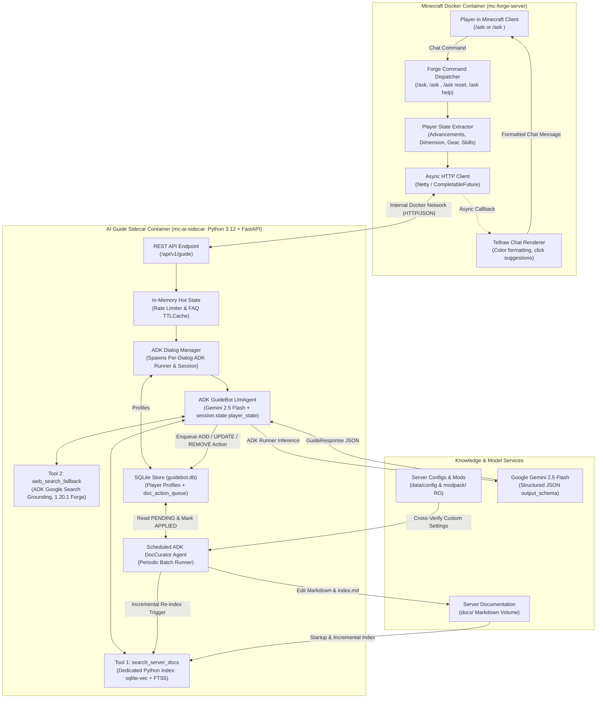
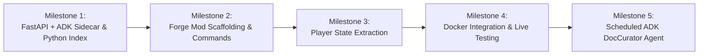

# Technical Design Document: Minecraft In-Game AI Guide ("Server GuideBot")

> **Companion To:**
> - [minecraft_ai_messaging_and_storage_tdd.md](./minecraft_ai_messaging_and_storage_tdd.md)
> - [minecraft_ai_doc_curator_tdd.md](./minecraft_ai_doc_curator_tdd.md)
>
> **Target Platform:** Minecraft Forge 1.20.1  
> **Interface:** In-Game Minecraft Native Chat (`/ask`, `/ask <question>`, `/ask reset`, `/ask help`)  
> **Status:** Approved Architecture (v1 — Google ADK + Dedicated Python Index + DocCurator)  
> **Author:** Antigravity Engineering Team  

---

## 1. Executive Summary & Problem Statement

### 1.1 Problem
In heavily modded Minecraft environments (featuring mods like *Twilight Forest*, *Passive Skill Trees*, *Farmer's Delight*, and *Biomes O' Plenty*), players constantly experience **progression paralysis**. The primary friction points are:
1. **Constant Alt-Tabbing:** Players must constantly switch to browser wikis, Discord, or YouTube to look up boss order, class mechanics, and recipes.
2. **Generic vs. Server-Specific Mechanics:** Online wikis often describe default mod behavior rather than the specific configurations, restrictions, and recipes tuned for this server.
3. **Context Disconnect:** External guides cannot see what the player has already achieved, forcing players to manually cross-reference their advancement logs.

### 1.2 Solution
A **server-side Minecraft Forge 1.20.1 mod** paired with a lightweight **Python + Google ADK AI Sidecar Service** that:
* Inspects the player's live in-game context (completed advancements, current dimension/biome, equipped items, and allocated skill tree classes).
* Spawns an isolated **Google ADK (`google-adk`) dialog instance** per user conversation so follow-up questions (`/ask`) naturally keep context without custom chat-history scaffolding.
* Always checks the server's authoritative [docs/](file:///home/wakaria/dev/minecraft-server/docs/) repository first via a **dedicated Python hybrid index (`sqlite-vec` + FTS5 BM25)**, falling back to **ADK Google Search Grounding (`Minecraft 1.20.1 Forge`)** when documentation is absent.
* Continuously closes documentation gaps via an asynchronous **`DocCurator` ADK agent** that converts live gap actions (`ADD` / `UPDATE` / `REMOVE`) into verified updates in `docs/` on a scheduled interval.
* Delivers concise, color-coded, spoiler-free Tellraw guidance directly into the native Minecraft chat without requiring custom client installations.

---

## 2. Core Architecture & Component Diagram



### 2.1 End-to-End Request Walkthrough
Every interaction follows a deterministic pipeline across the Minecraft server container (`mc-forge-server`) and the AI sidecar container (`mc-ai-sidecar`):

1. **Command Trigger & Live State Extraction (Java Mod):** A player runs `/ask` (progression check) or `/ask <question>`. The single server-side mod identifies the calling `ServerPlayer` (`player_uuid`) and extracts their condensed live state (dimension, biome, gear, skill class, progression advancements) in `< 1 ms`.
2. **Non-Blocking HTTP Dispatch (`Async HTTP Client`):** Using Java 17's `HttpClient.sendAsync(...)` (returning a `CompletableFuture`, analogous to a JS `Promise`), the mod sends an async `POST` to `http://mc-ai-sidecar:8000/api/v1/guide` over the internal Docker network so the 20 TPS Minecraft main loop never blocks.
3. **Cooldown & Stateless FAQ Check (`In-Memory Hot State`):** FastAPI enforces the 5-second per-player cooldown and checks `faq_cache` (`TTLCache`). Generic, stateless FAQ hits return cached JSON in `< 10 ms` at `$0` LLM cost.
4. **Profile Merge & Dialog Resolution (`ADK Dialog Manager` $\leftrightarrow$ `SQLiteDB`):** On cache miss (or any personalized query), deterministic Python code fetches the player's `player_profiles` row (`active_goal`, `recent_deaths`, `preferred_detail_level`) from `guidebot.db`, retrieves or spawns the player's isolated ADK `InMemoryRunner` + `Session` in `dialog_pool`, and merges the live + persistent state into `session.state["player_state"]`.
5. **ADK Runner Inference & Two-Tier Retrieval (`ADKAgent` $\leftrightarrow$ `LLM` / Tools):** ADK's `Runner` executes the loop against **Gemini 2.5 Flash**. The agent calls `search_server_docs` (`sqlite-vec` + FTS5) first to check authoritative server overrides, and invokes `web_search_fallback` (`Minecraft 1.20.1 Forge` pinned) only if local docs score `< 0.5` or lack sub-details.
6. **Conditional Doc Action Emission (`ADKAgent` $\rightarrow$ `SQLiteDB`):** When `docs/` lacked coverage or contained stale details and web fallback resolved the gap, a structured `DocAction` (`ADD` / `UPDATE` / `REMOVE`) is enqueued into `doc_action_queue` in `guidebot.db` for the scheduled `DocCurator` batch agent.
7. **Structured JSON & Private Tellraw Rendering (`ChatRenderer`):** Gemini returns strictly typed `GuideResponse` JSON via `output_schema`. The Java mod receives the HTTP callback, hops back onto the Minecraft main thread via `MinecraftServer.execute(...)`, and renders color-coded Tellraw text privately to `player.sendSystemMessage(...)`.

---

## 3. Detailed Component Breakdown

### 3.1 Forge Server Mod (`mc-guide-mod`)
* **Technology:** Java 17, Minecraft Forge MDK 1.20.1 (47.3.0+).
* **Deployment & Isolation Level:** **Server-Side Only** (`modpack/server-only/`). Zero client mod installation or client-side configuration is required.

#### Single Server Mod vs. Per-Player Isolation
There is **one** shared mod `.jar` (`mc-guide-mod.jar`) deployed on `mc-forge-server`, and **one** shared `mc-ai-sidecar` container—not one mod instance per player. Like a single backend HTTP API serving multiple connected users simultaneously:
* Every Brigadier command execution passes the calling player's `ServerPlayer` (`player_uuid`).
* The mod extracts **only that caller's** state and sends `player_uuid` to the sidecar, routing the call exclusively into that player's private ADK dialog session (`dialog_pool[player_uuid]`).
* Responses are delivered via `player.sendSystemMessage(...)` exclusively to that player, keeping other players' chats uncluttered.

#### Unified `/ask` Command Design
Combining progression coaching and freeform Q&A behind a single `/ask` root command reduces cognitive load for players and avoids Brigadier command-name collisions with other mods:
* `/ask` *(no arguments)* — Triggers a fresh progression evaluation based on live state (`query = null`) and evicts any prior ADK dialog session so the player gets a clean milestone check.
* `/ask <question...>` — Reuses the player's active ADK dialog session (within its 20-minute TTL) for natural multi-turn follow-up Q&A; spawns a fresh ADK session automatically if none is active.
* `/ask reset` — Explicitly clears the player's active ADK dialog instance so the next question starts with a clean slate.
* `/ask help` — Displays command syntax, examples, and cooldown rules directly in chat.

#### Async HTTP Client, `CompletableFuture`, and Netty Explained
> [!IMPORTANT]
> The Minecraft server main loop runs at **20 ticks per second (`50 ms` per tick)**. If a command waited synchronously for a ~600–900 ms LLM API call, the entire world (mobs, block breaking, movement) would freeze.

* **`Async HTTP Client` (`java.net.http.HttpClient`):** This is **not** a separate daemon or container—it is a thin Java helper class inside `mc-guide-mod.jar` using the JDK's built-in non-blocking `HttpClient.sendAsync(...)` (equivalent to `fetch()` in JavaScript) to `POST` JSON over the Docker network to `http://mc-ai-sidecar:8000/api/v1/guide`.
* **`CompletableFuture<T>`:** Java's standard asynchronous promise primitive (functionally analogous to JS `Promise<T>`, where `.thenApply` $\approx$ `.then`, `.thenAccept` $\approx$ `.then` side-effect, and `.exceptionally` $\approx$ `.catch`).
  * **Key Multi-Threading Distinction vs. JS:** Unlike Node.js's single-threaded event loop, Java executes `.thenAccept(...)` on a background HTTP worker thread. Because Minecraft entity/packet APIs are not thread-safe off the main loop, the callback **must** schedule packet delivery back onto the main server thread via `MinecraftServer.execute(() -> player.sendSystemMessage(...))`.
* **Clarification on Netty (`io.netty`):** Netty is Java's high-performance, non-blocking event-loop NIO framework (analogous to Node.js's `net` module + `libuv`). Minecraft bundles Netty natively to stream all game packets between clients and the server. For v1 REST communication with the AI sidecar, standard JDK `HttpClient.sendAsync()` + `CompletableFuture` handles non-blocking HTTP cleanly without writing custom Netty channel pipelines (Netty would only be touched directly if streaming or raw WebSocket/TCP framing were added in Phase 2).

#### `Tellraw Chat Renderer`
Minecraft chat does not render Markdown (`**bold**`, headings, `[links](url)`), so the **`Tellraw Chat Renderer`** acts as the mod's UI/view layer inside `mc-guide-mod.jar`:
* Parses the sidecar's `GuideResponse` JSON into native Minecraft `MutableComponent` trees (the programmatic Java backing behind `/tellraw`).
* Applies `ChatFormatting` semantic colors (`GREEN`, `YELLOW`, `AQUA`, `RED`) for clean, scannable formatting. *(Interactive `ClickEvent` buttons are deferred to Phase 2 to keep the v1 renderer and payload lightweight.)*

---

### 3.2 Player State Extraction Matrix

Both `/ask` *(no arguments)* and `/ask <question>` invoke the `StateExtractor` on the caller's `ServerPlayer` in `< 1 ms` in-memory before dispatching the HTTP request:

| Context Element | Data Source (Forge API) | Purpose for AI |
| :--- | :--- | :--- |
| **Advancements** | `ServerPlayer.getAdvancements()` | Pinpoints exact progression milestones (e.g. killed Naga, made Twilight portal, crafted furnace) while stripping `*:recipes/*` noise. |
| **Dimension & Biome** | `ServerPlayer.level().dimension()`, `ServerPlayer.getOnPos()` | Contextualizes danger and location-specific tasks. |
| **Inventory & Equipment** | `ServerPlayer.getInventory()`, `CuriosApi.getCuriosHelper()` | Evaluates gear readiness (e.g. iron vs diamond, food supplies). |
| **Passive Skill Tree** | Mod capabilities / tag storage on player | Knows the player's chosen class (Miner, Blacksmith, Enchanter, Cook, Hunter, Alchemist) and spent/unspent points. |
| **Health & Stats** | `ServerPlayer.getHealth()`, `ServerPlayer.getFoodData()` | Identifies urgent survival needs. |

#### Why `/ask <question>` Also Sends Live `PlayerState`
1. **State-Aware Specific Questions:** Players can ask `/ask am I ready for the Lich?` or `/ask what should I spend my 3 skill points on?` directly without needing a separate progression command first.
2. **Real-Time Mid-Dialog Updates:** If a player equips a shield or enters a new biome between follow-up turns, the agent sees the updated equipment/location immediately.
3. **Zero Bloat Cost:** Extraction runs in `< 1 ms`, the condensed JSON payload is only ~300–500 bytes, and ADK's state injection replaces the snapshot in place rather than appending it to chat history.

#### Persistent Profile Enrichment + ADK `session.state["player_state"]` Injection
Before calling Gemini, the `ADK Dialog Manager` deterministically reads `player_profiles` from `guidebot.db` and merges it with the live Java payload (`{ ...live_state, ...sqlite_profile }`):
* **Live from Java:** `dimension`, `biome`, `health`, `food_level`, `equipped`, `advancements_completed`, `skill_tree`.
* **Persistent from SQLite:** `active_goal` (e.g., `"Defeat Twilight Lich"`), `recent_deaths` (last 3 death causes for targeted combat advice), and `preferred_detail_level` (`"concise"` vs `"detailed"`).

In Google ADK, referencing `{player_state}` inside `LlmAgent.instruction` behaves like a dynamic template variable: right before calling `runner.run_async(...)`, the sidecar updates `session.state["player_state"]` via `EventActions(state_delta=...)`, causing ADK to render the freshest JSON directly into the system prompt on every turn without duplicating JSON inside conversation events.

**Why Inline `{player_state}` Instead of a `get_player_state()` Tool?**
* **Lower latency (saves 1 LLM round-trip):** The model sees dimension, gear, skill points, and advancements on Turn 1 instead of spending ~400–600 ms calling a tool first.
* **Lower token cost:** Inlining ~150–200 condensed tokens is **4–5x cheaper** than adding an extra tool-calling turn that re-sends the full system prompt, tool schemas, and chat history (~800–1,200 tokens).
* **Clean history + passive awareness:** `session.state["player_state"]` overwrites in place instead of leaving stale tool outputs inside `session.events`, and lets the model notice things like unspent Skill Points even when not explicitly asked. *(Only heavyweight data such as a full 36-slot inventory dump would belong behind an on-demand tool if added in a future phase.)*

```python
# Agent definition references {player_state} in its system instruction
guide_agent = LlmAgent(
    name="GuideBot",
    model="gemini-2.5-flash",
    instruction="... Current Player State:\n{player_state}",
    tools=[search_server_docs, web_search_fallback],
    output_schema=GuideResponse,
)

# Per-request update before runner.run_async(...)
merged_state = {**request.player_state, **sqlite_profile}
await session_service.append_event(
    session,
    Event(author="system", actions=EventActions(state_delta={"player_state": json.dumps(merged_state)})),
)
```

#### Sample Merged State Injected into `session.state["player_state"]`:
```json
{
  "player_name": "Wakaria",
  "dimension": "twilightforest:twilight_forest",
  "biome": "twilightforest:firefly_forest",
  "health": 20.0,
  "food_level": 18,
  "equipped": {
    "helmet": "minecraft:iron_helmet",
    "chestplate": "minecraft:iron_chestplate",
    "mainhand": "minecraft:iron_sword"
  },
  "advancements_completed": [
    "minecraft:story/mine_stone",
    "minecraft:story/smelt_iron",
    "twilightforest:root",
    "twilightforest:progress_naga"
  ],
  "skill_tree": {
    "class": "hunter",
    "spent_points": 14,
    "unspent_points": 3
  },
  "active_goal": "Defeat Twilight Lich",
  "recent_deaths": ["Naga melee charge"],
  "preferred_detail_level": "concise"
}
```

---

### 3.3 AI Sidecar Service (`mc-ai-sidecar`)
* **Technology:** **Python 3.12 + FastAPI + Pydantic + Google ADK (`google-adk`)** running as a companion container in `docker-compose.yml` (analogous to Fastify/Express + Zod + async event loop in Node.js; no Redis container required for v1).
* **Core Sub-Components:**
  1. **`In-Memory Hot State (Rate Limiter & FAQ TTLCache)`:**
     * Uses `cachetools.TTLCache` (equivalent to `lru-cache` with TTL expiration in JS) for a 5-second per-player cooldown, 24-hour daily quota counters, and a 1-hour **`FAQ TTLCache`**.
     * **FAQ Cache Behavior:** Common **stateless** questions (*"how do I craft a cutting board?"*, *"twilight forest portal recipe"*) hit `faq_cache` and return the saved `GuideResponse` JSON in **`< 10 ms`** at **`$0` Gemini token cost**. Personalized progression requests (`/ask` with no args, *"am I ready for X?"*) bypass `faq_cache`.
  2. **`ADK Dialog Manager (Spawns Per-Dialog ADK Runner & Session)`:**
     * Maintains `dialog_pool: TTLCache[player_uuid, AdkDialogInstance]` (`maxsize=200`, **20-minute** sliding inactivity TTL).
     * Each user dialog owns an isolated ADK `InMemoryRunner` + `Session` managed by ADK's built-in **`InMemorySessionService`**. Because ADK automatically records user queries, tool calls, tool outputs, and agent responses as session `Event`s, **no custom chat-history serialization or summarization code needs to be written**.
     * Running no-arg `/ask` or `/ask reset` evicts the player's current entry and spawns a fresh ADK dialog instance; follow-up `/ask <question>` calls within 20 minutes reuse the active instance so contextual follow-ups work seamlessly.
  3. **`ADK GuideBot LlmAgent` & `ADK Runner Inference`:**
     * `LlmAgent` binds the model (`gemini-2.5-flash`), instruction template (`{player_state}`), tools, and output schema (`GuideResponse`).
     * **`ADK Runner Inference`** is `runner.run_async(...)` executing the full reasoning loop against Gemini: sending prompt + `{player_state}` + session history, invoking any requested Python tool functions (`search_server_docs` first, then `web_search_fallback` only on low relevance `< 0.5` or missing detail), feeding tool results back to Gemini, and emitting the final structured answer.
  4. **`Google Gemini 2.5 Flash (Structured JSON output_schema)`:**
     * Gemini 2.5 Flash provides sub-second generation latency and low token cost. Passing Pydantic's `GuideResponse` model as `output_schema` constrains Gemini at the API level to return strictly valid JSON matching the Tellraw contract—preventing raw Markdown leakage or deserialization failures in Java.
  5. **`SQLite Store (guidebot.db)` — Dual Access Pattern (Why Dialog Manager & Agent Both Connect):**
     * `guidebot.db` is an embedded file database (like `better-sqlite3` in Node.js) holding `player_profiles` and `doc_action_queue`.
     * **Direct from `ADK Dialog Manager` (Deterministic pre-turn read / post-turn state update):** Reading `player_profiles` happens deterministically on every request *before* invoking the model (`< 1 ms`, `$0` tokens) so we never waste an LLM tool-call round-trip just to load user preferences or `active_goal`.
     * **From `ADK GuideBot LlmAgent` (Conditional post-reasoning write):** Only when `GuideBot` discovers during reasoning that `docs/` lacked coverage or contained outdated facts (and resolved the gap via `web_search_fallback`) does it emit a `DocAction` (`ADD` / `UPDATE` / `REMOVE`) into `doc_action_queue`.

#### 3.3.1 Concurrency, Queueing & Capacity Characteristics
* **No Sequential Request Queue:** Live `/ask` calls execute **concurrently** via Java `HttpClient.sendAsync()` and FastAPI's `asyncio` event loop (matching Node.js async I/O concurrency). Five players typing `/ask` at the same second all run in parallel and complete in ~600–900 ms.
* **Single-Container Headroom (~350–500 MB RAM):** Because Gemini API calls and web grounding are network I/O (`await`), one FastAPI worker easily handles **20–50+ concurrent `/ask` requests**, far exceeding typical modded server demand (5–30 online players).
* **Actual Runtime Bottlenecks & Mitigations:**
  1. **Gemini API RPM Quota:** External API rate limits (requests/tokens per minute) are reached long before Python saturates; mitigated by `FAQ TTLCache` + 5-second per-player cooldowns.
  2. **Query Vectorization CPU (`fastembed` ONNX):** Generating a query embedding takes ~10–25 ms of CPU; offloaded via `await asyncio.to_thread(...)` so `sqlite-vec` / `FTS5` searches (`< 2 ms`) never stall the `asyncio` event loop.
  3. **Per-Player Session Concurrency:** The 5-second cooldown plus an optional per-`player_uuid` `asyncio.Lock` ensures two rapid requests from the *same* player never mutate the same ADK `Session` concurrently.

---

### 3.4 Self-Improving Documentation Pipeline (`DocCurator` Agent)
> [!NOTE] Full Design Specification
> See [minecraft_ai_doc_curator_tdd.md](./minecraft_ai_doc_curator_tdd.md) for the complete `DocAction` schema, Mermaid sequence diagram, server-config cross-verification rules, and sandboxing guardrails.

To ensure `docs/` evolves automatically as players uncover missing or outdated mod guides without adding latency to live in-game chat:
1. **Real-Time Action Queueing (`doc_action_queue`):** When `GuideBot` falls back to web search or detects stale doc content while answering `/ask`, it asynchronously inserts a compact action (`ADD`, `UPDATE`, or `REMOVE`) with the verified 1.20.1 Forge facts and source URLs into SQLite.
2. **Scheduled ADK Curator Agent:** Runs on a periodic interval (every **6 hours** via APScheduler, or early when $\ge 5$ actions are `PENDING`, plus an admin `/api/v1/curator/run` endpoint) so the action queue stays small and batched.
3. **Config Verification & Obsidian Authoring:** The ADK `DocCurator` agent deduplicates pending actions, cross-checks `data/config/`, `data/defaultconfigs/`, and active mod JARs so custom server settings always override generic wiki defaults, updates the target Markdown note (plus `docs/index.md` for new files), and triggers an incremental `sqlite-vec` + `FTS5` re-index so future `/ask` calls answer directly from `docs/`.

---

## 4. In-Game Chat UX & Output Formatting

Minecraft chat has strict formatting rules:
- Total readable width is roughly 40-50 characters per line depending on font settings.
- Responses must be concise, structured, and avoid wall-of-text spam.

### Formatting & Spoiler-Free Standard:
- **Prefix:** `§6[GuideBot]§r ` (Gold tag)
- **Direct Recommendation:** 1-2 short sentences.
- **Next Steps (`1–3` flexible items):** Color-coded by step `style`:
  - Green (`§a`) for location / objective (`objective`).
  - Yellow (`§e`) for required item or craft (`item`).
  - Cyan (`§b`) for readiness / general tips (`tip`).
  - Red (`§c`) for hazard warnings (`warning`).
- **Spoiler-Free Default Policy:** Progression checks (`/ask` with no args) only reveal **what** the next milestone is, **where** to find it (`objective`), and **readiness hints** (`tip`). Boss fight tactics, weaknesses, and puzzle solutions are **omitted by default** and only provided if the player explicitly asks *how* (e.g., `/ask how do I fight the Twilight Lich?`).

#### Example In-Game Output (`/ask` — Spoiler-Free):
```text
[GuideBot] You've conquered the Naga! Your next objective in the Twilight Forest is the Twilight Lich.
 • Location: Look for a tall Lich Tower spire in the Twilight Forest.
 • Readiness: You have 3 unspent Skill Points—press O to boost Hunter draw speed.
```

---

## 5. Security & Resource Safeguards

1. **API Key Isolation:**
   - The Gemini API key remains inside the server sidecar environment file (`.env`). It is never transmitted across the Minecraft protocol or shared with game clients.
2. **Quota Protection:**
   - Stateless FAQ responses are cached in Python `TTLCache` for 1 hour (`zero` Gemini calls on cache hits), and per-player 5-second cooldowns + daily quotas prevent `/ask` spam.
3. **Offline Fallback:**
   - If the external AI API is unreachable or times out, the mod falls back gracefully:  
     `§c[GuideBot] My scrying orb is cloudy right now. Please try again in a moment!§r`

---

## 6. Implementation Roadmap & Milestones



### Milestone 1: FastAPI + ADK Sidecar & Dedicated Python Index
- Stand up `mc-ai-sidecar` (Python 3.12 + FastAPI + `google-adk`) in `docker-compose.yml` (no Redis container needed).
- Mount `docs/` and build the dedicated Python hybrid indexer (`sqlite-vec` + FTS5 BM25) that chunks by Markdown `##` headers and YAML frontmatter, auto-reindexing on startup/file hash changes.
- Implement per-dialog ADK instance pooling (`InMemoryRunner` + `InMemorySessionService` + `session.state["player_state"]`), `search_server_docs` + `web_search_fallback`, Pydantic `GuideResponse` schema, and `guidebot.db` (`player_profiles` + `doc_action_queue`).

### Milestone 2: Forge 1.20.1 Mod Scaffolding
- Set up a clean Forge 1.20.1 Gradle project in a new subdirectory (`projects/mc-ai-guide-mod/`).
- Register `/ask` (no-arg progression check), `/ask <query>`, `/ask reset`, and `/ask help` using Brigadier command syntax.
- Implement asynchronous `CompletableFuture` HTTP client to call `mc-ai-sidecar` and render structured Tellraw JSON responses.

### Milestone 3: Player State Collector
- Write advancement parser extracting progression nodes (`twilightforest:progress_*`, `minecraft:story/*`, `minecraft:nether/*`, `minecraft:end/*`, `farmersdelight:*`) while filtering `*:recipes/*` noise.
- Inspect inventory, equipment, Curios, dimension/biome, and `PassiveSkillTree` data.

### Milestone 4: Deployment & Verification
- Compile server `.jar`, place in `modpack/server-only/`.
- Deploy `mc-ai-sidecar` + updated `mc-forge-server` via `docker compose up -d`.
- Validate live in-game `/ask` (progression check) and multi-turn `/ask <question>` execution without client modifications.

### Milestone 5: Self-Improving Documentation Curator
- Implement asynchronous `DocAction` emission (`ADD` / `UPDATE` / `REMOVE`) into `doc_action_queue`.
- Add the scheduled `DocCurator` ADK agent (APScheduler every 6h / threshold trigger + `/api/v1/curator/run`), read-only server config inspection, Obsidian-formatted Markdown authoring, and incremental index refresh.

---

## 7. Resolved Architectural Decisions (v1 Locked)

1. **Agent Framework:** **Python 3.12 + FastAPI + Google ADK (`google-adk`)** — Per-dialog ADK instances with built-in `InMemorySessionService` and `session.state` injection (no custom chat history implementation needed).
2. **Knowledge Store:** **Dedicated Python Index (`sqlite-vec` + SQLite FTS5 BM25 over `docs/`)** — Decoupled from Obsidian GUI/plugins, auto-reindexes on `git pull`/startup, and pairs with ADK Google Search Grounding (`Minecraft 1.20.1 Forge`) as fallback.
3. **Self-Updating Docs:** **Two-Stage `DocCurator` Pipeline** — Live queries emit `ADD`/`UPDATE`/`REMOVE` actions into SQLite (`doc_action_queue`); a scheduled ADK `DocCurator` agent verifies server configs, updates `docs/`, and triggers incremental re-indexing.
4. **Hot State & Caching:** **No Redis in v1** — Uses in-memory `cachetools.TTLCache` for active ADK dialog instances, rate limits, and FAQ cache; `guidebot.db` (SQLite) stores persistent `player_profiles` and `doc_action_queue`.
5. **Target Model:** **Google Gemini 2.5 Flash** via ADK `LlmAgent` with strict `output_schema=GuideResponse`.
