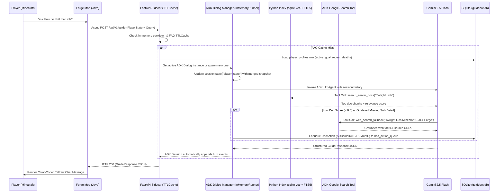

# Technical Design Document: Messaging Architecture, Response Contract & Storage

> **Companion To:**
> - [minecraft_ai_guide_tdd.md](./minecraft_ai_guide_tdd.md)
> - [minecraft_ai_doc_curator_tdd.md](./minecraft_ai_doc_curator_tdd.md)
>
> **Scope:** Inter-service communication, structured AI response schema, Google ADK per-dialog lifecycle, and storage (In-Memory + SQLite, No Redis in v1)  
> **Status:** Approved Architecture (v1)  

---

## 1. AI Response Contract (Sidecar $\rightarrow$ Minecraft Mod)

### 1.1 Why Structured JSON Instead of Raw Markdown?
Minecraft's native chat engine **does not parse Markdown** (`**bold**`, `# headers`, or `[links](url)` render as ugly raw symbols). Using structured JSON lets the Java mod construct clean `MutableComponent` trees with deterministic `ChatFormatting` semantic colors and consistent formatting.

Therefore, the ADK `LlmAgent` enforces a **Pydantic `GuideResponse` model** via ADK's `output_schema` parameter (backed by Gemini Structured Outputs), guaranteeing the sidecar always returns valid JSON rather than raw prose.

### 1.2 Response JSON Schema (`GuideResponse`)

```json
{
  "summary": "You have defeated the Naga. Your next Twilight Forest boss is the Twilight Lich.",
  "steps": [
    {
      "label": "Location",
      "text": "Look for a tall Lich Tower spire in the Twilight Forest.",
      "style": "objective"
    },
    {
      "label": "Readiness",
      "text": "You have 3 unspent Skill Points—press O to invest in Hunter draw speed.",
      "style": "tip"
    }
  ],
  "meta": {
    "source_type": "server_docs",
    "cache_hit": false,
    "latency_ms": 620
  }
}
```

* **`steps` Array (`1–3` items):** Flexible list of `{ label, text, style }` objects—labels such as `"Strategy"` are **not** required.
* **`meta.source_type` values:** `"server_docs"` | `"web_fallback"` | `"faq_cache"`

#### Spoiler-Free Default Policy
To preserve player discovery and avoid spoiling boss fights or puzzles:
* **Progression queries (`/ask` with no args or *"what should I do next?"*):** Only reveal **what/where** the next milestone is (`objective`) and **readiness/preparation hints** (`tip`). Do **not** include combat tactics, boss weaknesses, or puzzle walkthroughs by default.
* **Explicit how-to queries (`/ask how do I fight the Lich?`):** Only when the player explicitly asks *how* to defeat a boss, craft an item, or solve a mechanic should the response include strategy or step-by-step instructions.

### 1.3 Minecraft Chat Rendering Rules (Java Mod)
* **`style` Color Mapping (`ChatFormatting`):**
  * `objective` $\rightarrow$ `ChatFormatting.GREEN` (`§a`)
  * `item` $\rightarrow$ `ChatFormatting.YELLOW` (`§e`)
  * `tip` $\rightarrow$ `ChatFormatting.AQUA` (`§b`)
  * `warning` $\rightarrow$ `ChatFormatting.RED` (`§c`)
* **v1 Scope (Text + Colors Only):** Interactive `ClickEvent` buttons (`suggested_followups`, `[Open Web Guide]`) are omitted in v1 to keep the Java renderer and JSON payload minimal, and remain an optional Phase 2 enhancement.

---

## 2. Messaging & ADK Per-Dialog Lifecycle



### 2.1 Mod-to-Sidecar Transport Architecture

| Architecture | How It Works | Pros | Cons | Best For |
| :--- | :--- | :--- | :--- | :--- |
| **1. Async HTTP/REST** *(Selected for v1)* | Mod sends async `POST` via Java `HttpClient` + `CompletableFuture` to FastAPI sidecar. | Simplest to build, debug, and test; zero broker/Redis dependencies in Java; stateless HTTP transport. | Server cannot push unprompted notifications without polling. | `/ask` and `/ask <question>` request-response chat. |
| **2. Persistent WebSocket** *(Optional Phase 2)* | Mod maintains one persistent WS connection to Sidecar over the Docker network. | Sub-millisecond framing; enables **proactive AI whispers** (e.g. player enters a new dimension or dies 3x). | Requires reconnect/backoff logic in Java. | Proactive companion tips. |

---

### 2.2 How Per-Dialog ADK Instances & Chat History Work

#### 1. Do We Need to Implement Custom Chat History? **No.**
Using **Google ADK (`google-adk`)**, conversation memory is handled out of the box by ADK's built-in **`InMemorySessionService`**:
* Every call to `runner.run_async(...)` automatically records the user's message, tool calls (`search_server_docs`, `web_search_fallback`), tool results, and the final JSON answer as `Event` objects inside that dialog's ADK `Session`.
* On the next `/ask` inside the same dialog, ADK automatically loads and replays the session's turns to Gemini—we write **zero** custom history serialization, Redis list management, or summary logic.

#### 2. Per-Dialog ADK Instance Spawning (`dialog_pool`)
Each player dialog runs against its own isolated ADK dialog instance managed by a Python `cachetools.TTLCache(maxsize=200, ttl=1200)` keyed by `player_uuid`:
* **When a new ADK Dialog Instance is spawned:**
  1. Player has no active dialog in `dialog_pool` (first question or >20 minutes since last message).
  2. Player runs `/ask` with no arguments (starts a clean progression check).
  3. Player explicitly runs `/ask reset`.
* **When the existing ADK Dialog Instance is reused:**
  * Follow-up `/ask <question>` commands sent within the **20-minute inactivity TTL** reuse the player's active ADK `InMemoryRunner` + `Session`, allowing natural follow-ups like `/ask where do I find that tower?` or `/ask what does he drop?`.
* **Automatic Cleanup:** Once 20 minutes pass with no queries, `TTLCache` evicts the instance and frees memory automatically.

#### 3. Keeping History Tiny with `session.state["player_state"]`
Instead of prepending a 500-token `PlayerState` JSON blob into every user chat message (which would accumulate across turns and bloat history), the sidecar writes the latest live `PlayerState` into **`session.state["player_state"]`** before each turn and references `{player_state}` in the `LlmAgent` instruction template. ADK dynamically renders the current state into the system prompt on every turn while keeping chat turns strictly focused on user questions and concise answers.

---

## 3. Storage & Database Architecture (No Redis in v1)

### 3.1 In-Memory Hot State (`cachetools.TTLCache`)
Rather than running a separate Redis container for a small-group server in v1, all hot ephemeral state lives in Python RAM inside `mc-ai-sidecar`:

| Store Key / Structure | Implementation | TTL | Purpose |
| :--- | :--- | :--- | :--- |
| **`dialog_pool[player_uuid]`** | `TTLCache(maxsize=200, ttl=1200)` | 20 min (sliding) | Holds active per-dialog ADK `Runner` + `Session` instance. |
| **`cooldowns[player_uuid]`** | `TTLCache(maxsize=500, ttl=5)` | 5 sec | Prevents `/ask` spam and accidental double-triggers. |
| **`daily_quotas[uuid:date]`** | `TTLCache(maxsize=1000, ttl=86400)` | 24 hours | Protects Gemini API budget with per-player daily caps. |
| **`faq_cache[normalized_hash]`** | `TTLCache(maxsize=500, ttl=3600)` | 1 hour | Returns `<10ms` cached JSON at `$0` LLM cost for stateless questions (*"cutting board recipe"*, *"twilight portal"*). |

> [!NOTE] When Would Redis Be Added (Phase 2)?
> Redis is deferred to Phase 2 and only needed if running multiple Minecraft servers (e.g., Lobby + Survival + Skyblock) sharing one scaled sidecar fleet, or if quotas/caches must persist across container restarts.

---

### 3.2 Dedicated Python Knowledge Index (`sqlite-vec` + FTS5 over `docs/`)

To ensure zero coupling with the Obsidian desktop GUI/plugins and instant updates whenever `docs/` changes on the server (including edits written by the scheduled `DocCurator` agent), the sidecar maintains its own **dedicated Python hybrid index**:

* **Ingestion & Chunking:** Reads `/docs/**/*.md` from the mounted vault. Parses YAML frontmatter (`mod`, `tags`, `title`) and splits documents cleanly along `##` / `###` Markdown section headers so chunks remain cohesive and self-contained.
* **Hybrid Retrieval (`search_server_docs`):**
  * **Semantic Vector Search:** `sqlite-vec` storing local `fastembed` (`BAAI/bge-small-en-v1.5`) or Gemini text embeddings.
  * **Keyword Exact Match:** SQLite `FTS5` (BM25) so exact Minecraft item/mod IDs (`ItemProductionLib`, `PassiveSkillTree`, `Waystones`) rank accurately.
  * **Incremental Re-Index:** Stores SHA-256 file hashes on startup and after every `DocCurator` batch run so updates take ~1–3 seconds to re-index only modified files.

#### Vector Store Trade-off Comparison

| Variant | Pros | Cons |
| :--- | :--- | :--- |
| **Dedicated Python Index (`sqlite-vec` + FTS5)** *(Selected)* | • Auto-reindexes on `git pull`, container start, and `DocCurator` runs<br>• Custom `##` header chunking & frontmatter filtering<br>• Completely decoupled from Obsidian plugins | • ~2–5s indexing on startup when docs change<br>• Small duplicate index file (~5–20 MB) |
| *Reuse `docs/.obsidian-hybrid-search.db`* *(Rejected)* | • Zero duplicate indexing<br>• Single file shared with Obsidian | • **Only updates when Obsidian GUI runs** (stale on headless server & misses `DocCurator` edits)<br>• Coupled to plugin's internal SQLite schema & model weights |

---

### 3.3 Persistent SQLite Database (`guidebot.db`)
Stored on a persistent Docker volume (`/app/data/guidebot.db`), SQLite handles cold/durable player context and the `DocCurator` action queue:

#### Table 1: `player_profiles` *(Improves personalized AI responses)*
Instead of archiving every chat message, store only compact signals that make future answers noticeably smarter:

```sql
CREATE TABLE IF NOT EXISTS player_profiles (
    player_uuid TEXT PRIMARY KEY,
    player_name TEXT NOT NULL,
    active_goal TEXT,                -- e.g. "Defeat Twilight Lich" (set by /ask or player)
    preferred_detail_level TEXT DEFAULT 'concise', -- 'concise' | 'detailed'
    recent_deaths_json TEXT DEFAULT '[]',          -- Last 3 death causes for survival tips
    playstyle_notes TEXT,            -- e.g. "Prefers bow/ranged builds, Hunter class"
    updated_at DATETIME DEFAULT CURRENT_TIMESTAMP
);
```

#### Table 2: `doc_action_queue` *(Drives scheduled `DocCurator` updates to `docs/`)*
Replaces passive gap logging with an actionable queue consumed by the scheduled `DocCurator` ADK agent (see [minecraft_ai_doc_curator_tdd.md](./minecraft_ai_doc_curator_tdd.md)):

```sql
CREATE TABLE IF NOT EXISTS doc_action_queue (
    id INTEGER PRIMARY KEY AUTOINCREMENT,
    action_type TEXT NOT NULL,       -- 'ADD' | 'UPDATE' | 'REMOVE'
    target_doc_path TEXT,            -- e.g. "02-dimensions-and-bosses/twilight-forest-progression.md"
    topic TEXT NOT NULL,
    player_query TEXT NOT NULL,
    rag_top_score REAL NOT NULL,
    verified_facts_json TEXT NOT NULL, -- Concise facts gathered via web_search_fallback
    source_urls_json TEXT NOT NULL,
    status TEXT DEFAULT 'PENDING',   -- 'PENDING' | 'IN_PROGRESS' | 'APPLIED' | 'SKIPPED'
    created_at DATETIME DEFAULT CURRENT_TIMESTAMP,
    processed_at DATETIME
);
```

---

## 4. Token Optimization Strategy

To keep Gemini 2.5 Flash API costs near zero and latency under 1 second:
1. **Condensed Advancement Filtering:** Java sends only progression advancements (`twilightforest:progress_*`, `minecraft:story/*`, `minecraft:nether/*`, `minecraft:end/*`, `farmersdelight:*`) and drops all `*:recipes/*` noise.
2. **Skill Tree Summarization:** Instead of sending 98 raw skill node IDs, Java summarizes `PassiveSkillTree` data into:
   ```json
   "skill_tree": {
     "class": "hunter",
     "spent_points": 14,
     "unspent_points": 3,
     "key_highlights": ["bow_draw_speed", "arrow_retrieval"]
   }
   ```
3. **State Injection via `session.state`:** Injecting `{player_state}` into the ADK system instruction prevents re-accumulating player JSON inside every user message event.
4. **20-Minute Dialog TTL:** Short-lived per-dialog ADK instances naturally cap turn depth (typically 1–6 turns, ~0.6 KB per turn), keeping prompts compact without needing custom conversation summarizers.

---

## 5. Confirmed v1 Architecture Summary

| Decision Area | Confirmed Choice for v1 |
| :--- | :--- |
| **Agent Orchestration** | **Google ADK (`google-adk`)** spawning an isolated ADK dialog instance (`InMemoryRunner` + `InMemorySessionService`) per user dialog |
| **Chat History** | **Managed natively by ADK** (`InMemorySessionService` + 20m `TTLCache` eviction + no-arg `/ask` or `/ask reset`), no custom chat history code needed |
| **Mod-to-Sidecar Transport** | **Async HTTP/REST** (`CompletableFuture` in Forge Mod $\rightarrow$ FastAPI) |
| **Hot Cache & Rate Limits** | **No Redis in v1** — Python in-memory `cachetools.TTLCache` |
| **Knowledge / Vector Index** | **Dedicated Python Index** (`sqlite-vec` + SQLite FTS5 BM25 over `docs/`) |
| **Web Fallback** | **ADK Google Search Grounding** (`Minecraft 1.20.1 Forge` pinned) when local docs score `< 0.5` |
| **Self-Updating Docs** | **Scheduled ADK `DocCurator` Agent** consuming `doc_action_queue` (`ADD` / `UPDATE` / `REMOVE`), cross-checking server configs, editing `docs/`, and triggering incremental re-index |
| **Persistent DB** | **SQLite (`guidebot.db`)** for `player_profiles` and `doc_action_queue` |
