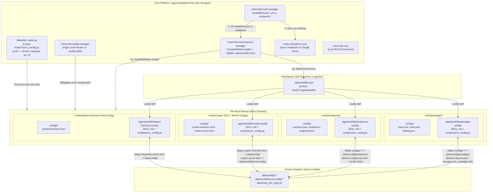
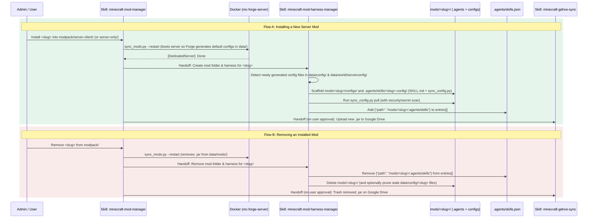
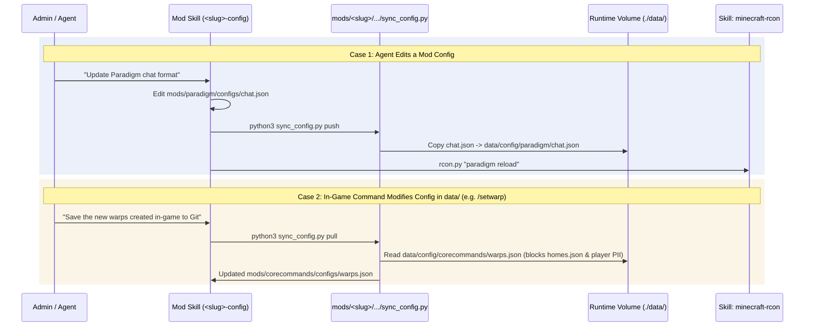

# Technical Design Document: Per-Mod Vertical Slice & AI Skill Harness Architecture

> **Companion To:**
> - [minecraft-server-operations.md](file:///home/wakaria/dev/minecraft-server/.agents/plugins/minecraft-manager/rules/minecraft-server-operations.md)
> - [minecraft-mod-installation.md](file:///home/wakaria/dev/minecraft-server/.agents/plugins/minecraft-manager/rules/minecraft-mod-installation.md)
> - [minecraft_ai_doc_curator_tdd.md](file:///home/wakaria/dev/minecraft-server/docs/dev/minecraft_ai_doc_curator_tdd.md)
>
> **Scope:** Per-mod directories (`mods/<mod-slug>/`) for every configured server mod, mod-local `sync_config.py` scripts with mod-specific path mapping and security guards, `minecraft-mod-harness-manager` skill for creating/deleting mod folders on install/uninstall, automatic config push on `docker compose up`, and direct skill registration in root `.agents/skills.json`  
> **Status:** Proposed Architecture (v4)  

---

## 1. Overview & Motivation

### 1.1 Why Self-Contained Per-Mod Slices Instead of Central Config Sync Skills?
In a modded Minecraft 1.20.1 Forge server, every mod has its own configuration layout and security surface inside the runtime `data/` directory:

- **Subfolder mods with databases & secrets:** `LuckPerms` (`data/config/luckperms/`) and `Paradigm Essentials` (`data/config/paradigm/`) mix safe JSON/conf files with SQLite/H2 databases (`*.mv.db`, `paradigm.db`), downloaded Maven JARs (`libs/`), and secret-bearing files (`discord.json`, `storage.json`, `luckperms.conf`).
- **Subfolder mods with player PII:** `CoreCommands` (`data/config/corecommands/`) mixes static server configs (`config.json`, `warps.json`, `rules.json`, `spawn.json`) with per-player coordinate and home files (`homes.json`, `lastlocation.json`, `deathlocation.json`, `logoutposition.json`).
- **Flat-file & multi-target mods:** Mods like `Create`, `Distant Horizons`, `SimpleBackups`, or `VanillaBackport` place single `.toml`/`.json` files directly at the root of `data/config/` (e.g., `data/config/DistantHorizons.toml`) and/or inside `data/world/serverconfig/` (e.g., `data/world/serverconfig/create-server.toml`).

Instead of maintaining a central `minecraft-config-sync` skill with a monolithic allowlist/exclusion table:

1. **Every configured server mod gets its own folder (`mods/<mod-slug>/`)**—whether its runtime files live in a `data/config/<mod>/` subfolder or as flat files in `data/config/` and `data/world/serverconfig/`.
2. **Every mod folder owns its own `<slug>-config` skill and `sync_config.py` script** that knows:
   - Exactly where its files belong inside `data/` (`data/config/...`, `data/world/serverconfig/...`, `data/defaultconfigs/...`).
   - Exactly which files, keys, or runtime databases/PII must be excluded or sanitized for that specific mod.
   - How to `push` (`mods/<slug>/configs/` $\rightarrow$ `data/`), `pull` (`data/` $\rightarrow$ `mods/<slug>/configs/` when a mod mutates its config dynamically at runtime), and `diff`.
3. **No `minecraft-config-sync` Skill Needed:**
   - **On Mod Installation:** `minecraft-mod-manager` hands off to **`minecraft-mod-harness-manager`**, which scaffolds `mods/<slug>/` and runs its initial `sync_config.py pull`.
   - **On Server Boot (`make up`):** `Makefile` automatically runs every `mods/*/.agents/skills/*/scripts/sync_config.py push` before `docker compose up -d`.
   - **During Live Operation:** When an agent edits a mod's config (or captures an in-game dynamic config change), the agent activates that mod's `<slug>-config` skill directly and runs its local `sync_config.py push` (or `pull`).
4. **Single Root `.agents/skills.json` (No Per-Mod `skills.json`):** The root `.agents/skills.json` lists `{ "path": "mods/<slug>/.agents/skills" }` directly in `"entries"`, so individual mod folders do not need their own `skills.json` files.

---

## 2. Architecture & Execution Flow Diagrams

### 2.1 Skill Discovery, Lifecycle Management & Direct Per-Mod Sync Topology



### 2.2 Mod Installation & Removal Lifecycle Sequence (`minecraft-mod-manager` $\rightarrow$ `minecraft-mod-harness-manager`)



### 2.3 Startup Sync (`make up`) & Dynamic Runtime Config Changes



---

## 3. Directory Structure & Per-Mod Layout

Every installed mod that produces server/world configuration files gets its own directory under `mods/<mod-slug>/` (plus `mods/server-core/` for `user_jvm_args.txt`, `fml.toml`, and `forge-server.toml`), with **no per-mod `skills.json`**:

```text
/home/wakaria/dev/minecraft-server/
├── .agents/
│   ├── skills.json                              # Root manifest listing mods/*/.agents/skills in entries[]
│   └── plugins/
│       └── minecraft-manager/
│           ├── plugin.json
│           ├── rules/
│           └── skills/
│               ├── minecraft-config-manager/        # High-level router & invariant guide
│               ├── minecraft-mod-harness-manager/   # Creates/deletes mods/<slug>/ & updates .agents/skills.json
│               │   ├── SKILL.md
│               │   └── scripts/
│               │       ├── create_mod_harness.py    # Scaffolds mods/<slug>/, sync_config.py, and skills.json entry
│               │       ├── remove_mod_harness.py    # Removes mods/<slug>/ and unregisters from skills.json
│               │       └── audit_unmapped.py        # Lists files in data/config/ not yet claimed by any mods/<slug>/
│               ├── minecraft-gdrive-sync/
│               ├── minecraft-mod-manager/           # Hands off to minecraft-mod-harness-manager on install/remove
│               ├── minecraft-permission-manager/
│               ├── minecraft-rcon/
│               └── minecraft-role-manager/
├── mods/                                        # One folder per configured mod (Git-tracked)
│   ├── server-core/                             # Vanilla/Forge core server files
│   │   ├── configs/
│   │   │   ├── user_jvm_args.txt
│   │   │   ├── fml.toml
│   │   │   └── forge-server.toml
│   │   └── .agents/
│   │       └── skills/
│   │           └── server-core-config/
│   │               ├── SKILL.md
│   │               └── scripts/
│   │                   └── sync_config.py
│   ├── paradigm/                                # Subfolder mod with secrets & SQLite DB
│   │   ├── configs/
│   │   │   ├── afk.json
│   │   │   ├── announcements.json
│   │   │   ├── chat.json
│   │   │   ├── commands.json
│   │   │   ├── dashboard.json
│   │   │   ├── emojis.json
│   │   │   ├── holograms.json
│   │   │   ├── main.json
│   │   │   ├── mentions.json
│   │   │   ├── moderation-settings.json
│   │   │   ├── motd.json
│   │   │   ├── restarts.json
│   │   │   ├── tablist.json
│   │   │   └── tickets.json
│   │   └── .agents/
│   │       └── skills/
│   │           └── paradigm-config/
│   │               ├── SKILL.md
│   │               └── scripts/
│   │                   └── sync_config.py
│   ├── luckperms/                               # Subfolder mod with H2 DB & RCON snapshot
│   │   ├── configs/
│   │   │   ├── contexts.json
│   │   │   └── luckperms-snapshot.json
│   │   └── .agents/
│   │       └── skills/
│   │           └── luckperms-config/
│   │               ├── SKILL.md
│   │               └── scripts/
│   │                   └── sync_config.py
│   ├── corecommands/                            # Subfolder mod with player runtime PII excluded
│   │   ├── configs/
│   │   │   ├── config.json
│   │   │   ├── rules.json
│   │   │   ├── spawn.json
│   │   │   └── warps.json
│   │   └── .agents/
│   │       └── skills/
│   │           └── corecommands-config/
│   │               ├── SKILL.md
│   │               └── scripts/
│   │                   └── sync_config.py
│   ├── create/                                  # Multi-location mod (data/config + data/world/serverconfig)
│   │   ├── configs/
│   │   │   ├── create-common.toml
│   │   │   └── create-server.toml
│   │   └── .agents/
│   │       └── skills/
│   │           └── create-config/
│   │               ├── SKILL.md
│   │               └── scripts/
│   │                   └── sync_config.py
│   ├── biomesoplenty/                           # Subfolder worldgen mod
│   │   ├── configs/
│   │   │   ├── biome_toggles.json
│   │   │   └── generation.toml
│   │   └── .agents/
│   │       └── skills/
│   │           └── biomesoplenty-config/
│   │               ├── SKILL.md
│   │               └── scripts/
│   │                   └── sync_config.py
│   └── distant-horizons/                        # Single flat-file mod in data/config/
│       ├── configs/
│       │   └── DistantHorizons.toml
│       └── .agents/
│           └── skills/
│               └── distant-horizons-config/
│                   ├── SKILL.md
│                   └── scripts/
│                       └── sync_config.py
├── modpack/                                     # Mod .jar binaries (gitignored, synced to Drive)
└── data/                                        # Live Docker runtime volume (gitignored)
```

---

## 4. Contract of Each Mod's `sync_config.py` Script

### 4.1 Uniform CLI Interface
Every mod's `mods/<slug>/.agents/skills/<slug>-config/scripts/sync_config.py` implements the same CLI contract so it can be run either **directly by an agent** working on that mod or **in a loop by `Makefile` on `make up`**:

```bash
python3 mods/<slug>/.agents/skills/<slug>-config/scripts/sync_config.py <push|pull|diff|mappings> [--dry-run] [--exit-code]
```

| Subcommand | Direction | Responsibility |
| :--- | :--- | :--- |
| `push` | `mods/<slug>/configs/` $\rightarrow$ `data/` | Places the mod's tracked config files into their exact target locations in `data/` (`data/config/...`, `data/world/serverconfig/...`, etc.) using `shutil.copyfile` (preserving UID/GID `1000`). |
| `pull` | `data/` $\rightarrow$ `mods/<slug>/configs/` | Reads only this mod's allowlisted files from `data/`, enforces this mod's security exclusions & secret scan, and updates `mods/<slug>/configs/` (used on initial mod installation or when in-game commands update a config dynamically). |
| `diff` | `mods/<slug>/configs/` $\leftrightarrow$ `data/` | Prints unified diff for this mod's mapped files (`--exit-code` returns `1` on drift). |
| `mappings` | Metadata output (JSON) | Prints the JSON map of `{local_config_rel: data_target_rel}` and `forbidden_data_paths` so `audit_unmapped.py` can detect unclaimed files in `data/`. |

### 4.2 How `find_repo_root()` Is Eliminated
Because every mod script lives at the exact fixed depth `mods/<slug>/.agents/skills/<slug>-config/scripts/sync_config.py`:

```python
from pathlib import Path

MOD_DIR = Path(__file__).resolve().parents[4]       # -> mods/<slug>/
REPO_ROOT = MOD_DIR.parent.parent                   # -> /home/wakaria/dev/minecraft-server/
MOD_CONFIGS_DIR = MOD_DIR / "configs"               # -> mods/<slug>/configs/
DATA_DIR = REPO_ROOT / "data"                       # -> data/
```

No directory walking is needed—both `MOD_CONFIGS_DIR` and `DATA_DIR` are resolved in 4 lines of deterministic path arithmetic.

### 4.3 Explicit Path Mapping & Mod-Specific Security Rules
Each mod's `sync_config.py` defines its own explicit `FILE_MAP` (mapping `mods/<slug>/configs/<local_name>` $\leftrightarrow$ `data/<target_rel_path>`) and its own `FORBIDDEN_RUNTIME_PATHS` / secret-scanning logic:

- **Example 1: Multi-location Flat Mod (`mods/create/.../sync_config.py`)**
  ```python
  FILE_MAP = {
      "create-common.toml": "config/create-common.toml",
      "create-server.toml": "world/serverconfig/create-server.toml",
  }
  ```
- **Example 2: Security-Sensitive Subfolder Mod (`mods/paradigm/.../sync_config.py`)**
  ```python
  # Explicitly allowlisted files in data/config/paradigm/
  ALLOWED_FILES = (
      "afk.json", "announcements.json", "chat.json", "commands.json",
      "dashboard.json", "emojis.json", "holograms.json", "main.json",
      "mentions.json", "moderation-settings.json", "motd.json",
      "restarts.json", "tablist.json", "tickets.json",
  )
  # Hard-blocked in pull/push (secrets, SQLite DB, runtime cooldown UUIDs, Maven libs)
  FORBIDDEN_NAMES = {"discord.json", "storage.json", "cooldowns.json", "discovered_permissions.json", "data", "libs"}
  ```
  Additionally, `paradigm`'s `sync_config.py` validates on `push` and `pull` that `"internalPermissionsEnable"` in `main.json` is `false` (enforcing the server invariant in code!).
- **Example 3: PII-Filtering Subfolder Mod (`mods/corecommands/.../sync_config.py`)**
  ```python
  ALLOWED_FILES = ("config.json", "rules.json", "spawn.json", "warps.json")
  # Never pull player UUID/coordinate files:
  FORBIDDEN_PII_FILES = {
      "afkstatus.json", "deathlocation.json", "homes.json",
      "lastlocation.json", "lastmessagerecipient.json",
      "logoutposition.json", "playerjoinstatus.json", "tparequests.json",
  }
  ```

---

## 5. New Skill: `minecraft-mod-harness-manager` & Updated `minecraft-mod-manager`

### 5.1 `minecraft-mod-harness-manager` (`.agents/plugins/minecraft-manager/skills/minecraft-mod-harness-manager/`)

This dedicated skill in `minecraft-manager` owns the **creation, auditing, and deletion of per-mod folders (`mods/<slug>/`)** and their registration in root `.agents/skills.json`.

#### Scripts Provided by `minecraft-mod-harness-manager`
1. **`scripts/audit_unmapped.py`**:
   ```bash
   python3 .agents/plugins/minecraft-manager/skills/minecraft-mod-harness-manager/scripts/audit_unmapped.py
   ```
   - Scans `data/config/` and `data/world/serverconfig/` and queries `mappings` from every `mods/*/.agents/skills/*/scripts/sync_config.py`, printing any newly generated config files not yet claimed (or explicitly forbidden) by a `mods/<slug>/` folder.

2. **`scripts/create_mod_harness.py`**:
   ```bash
   python3 .agents/plugins/minecraft-manager/skills/minecraft-mod-harness-manager/scripts/create_mod_harness.py <slug> \
     --map <local_name>:<data_rel_path> [--map ...] \
     [--forbid <data_rel_path> ...] \
     [--description "Manage and synchronize <Mod Name> server configurations."] \
     [--dry-run]
   ```
   - Validates that none of the `--map` paths contain secrets or collide with another mod's `sync_config.py`.
   - Creates `mods/<slug>/configs/`.
   - Generates `mods/<slug>/.agents/skills/<slug>-config/SKILL.md` and `mods/<slug>/.agents/skills/<slug>-config/scripts/sync_config.py` pre-populated with `FILE_MAP`, `FORBIDDEN_PATHS`, and secret scanning.
   - Runs `sync_config.py pull` to populate `mods/<slug>/configs/` from `data/`.
   - Adds `{"path": "mods/<slug>/.agents/skills"}` to root `.agents/skills.json` under `"entries"` (sorted, idempotent).

3. **`scripts/remove_mod_harness.py`**:
   ```bash
   python3 .agents/plugins/minecraft-manager/skills/minecraft-mod-harness-manager/scripts/remove_mod_harness.py <slug> \
     [--prune-data] [--dry-run]
   ```
   - Removes `{"path": "mods/<slug>/.agents/skills"}` from root `.agents/skills.json`.
   - Deletes the `mods/<slug>/` folder (its `configs/` and `.agents/` skill harness).
   - If `--prune-data` is passed, also removes the mod's mapped configuration files from `data/config/` and `data/world/serverconfig/`.

#### `minecraft-mod-harness-manager/SKILL.md` Runbook Steps
- **When Installing a Mod (Called by `minecraft-mod-manager`):**
  1. Run `audit_unmapped.py` to inspect any new config files generated in `data/config/` and `data/world/serverconfig/` after the server booted with the new mod.
  2. Audit the candidate files for sensitive keys (tokens, webhooks, DB credentials, player UUIDs) to decide what goes into `--map` vs. `--forbid`.
  3. Run `create_mod_harness.py <slug> --map ... [--forbid ...]` to scaffold `mods/<slug>/`, pull initial configs into `mods/<slug>/configs/`, and register `mods/<slug>/.agents/skills` in `.agents/skills.json`.
- **When Removing a Mod (Called by `minecraft-mod-manager`):**
  1. Preview removal with `remove_mod_harness.py <slug> --dry-run`.
  2. Execute `remove_mod_harness.py <slug>` (optionally with `--prune-data` if runtime config files should also be removed from `data/`).

---

### 5.2 Updated `minecraft-mod-manager/SKILL.md` Workflow

[minecraft-mod-manager/SKILL.md](file:///home/wakaria/dev/minecraft-server/.agents/plugins/minecraft-manager/skills/minecraft-mod-manager/SKILL.md) is updated so that adding or removing a mod in `modpack/` always keeps `mods/<slug>/` and `.agents/skills.json` synchronized:

- **Step 1:** Discover & Inspect Mod Compatibility (`query_modrinth.py <slug>`)
- **Step 2:** Download Mod into Target Category (`modpack/server-client/`, `modpack/server-only/`, or `modpack/client-only/`)
- **Step 3:** Synchronize Modpack & Restart Server (`sync_mods.py --restart`)
- **Step 4:** Verify Server Health (`docker compose logs --tail=50 mc` reports `Done`)
- **Step 5 (NEW): Create or Remove Mod Config Folder & Harness (`minecraft-mod-harness-manager` Handoff)**
  - **After Installing a Server Mod (`server-client` or `server-only`):**
    Activate the **`minecraft-mod-harness-manager`** skill (`audit_unmapped.py` $\rightarrow$ `create_mod_harness.py <slug>`) to create `mods/<slug>/` (`configs/` + `.agents/skills/<slug>-config/`), pull the newly generated configs from `data/`, and register `mods/<slug>/.agents/skills` in `.agents/skills.json`.
  - **After Removing a Server Mod:**
    Activate the **`minecraft-mod-harness-manager`** skill (`remove_mod_harness.py <slug>`) to delete `mods/<slug>/` and remove its entry from `.agents/skills.json`.
- **Step 6:** Synchronize `.jar` Files with Google Drive (`minecraft-gdrive-sync` Handoff)

---

## 6. Automatic Startup Sync (`Makefile`) & Root `.agents/skills.json`

### 6.1 Automatic Execution on `docker compose up` (`Makefile`)
In [Makefile](file:///home/wakaria/dev/minecraft-server/Makefile), `up` runs a lightweight loop over all `mods/*/.agents/skills/*/scripts/sync_config.py push` before starting the container—requiring no central sync skill:

```makefile
up: config-push ## Sync all mod configs into data/ and start Minecraft server
	docker compose up -d

config-push: ## Push all mods/*/configs/ into data/
	@for script in mods/*/.agents/skills/*/scripts/sync_config.py; do \
		python3 "$$script" push || exit 1; \
	done

config-push-dry: ## Preview pushing all mods/*/configs/ into data/
	@for script in mods/*/.agents/skills/*/scripts/sync_config.py; do \
		python3 "$$script" push --dry-run || exit 1; \
	done

config-pull: ## Pull runtime configs from data/ into each mods/<slug>/configs/
	@for script in mods/*/.agents/skills/*/scripts/sync_config.py; do \
		python3 "$$script" pull || exit 1; \
	done

config-diff: ## Show unified diff across all mods/*/configs/ vs data/
	@for script in mods/*/.agents/skills/*/scripts/sync_config.py; do \
		python3 "$$script" diff || exit 1; \
	done
```

### 6.2 Root `.agents/skills.json` (Direct `entries`, No Per-Mod `skills.json`)
At the repository root, `.agents/skills.json` points directly to each mod's `.agents/skills` directory:

```json
{
  "entries": [
    { "path": "mods/attributefix/.agents/skills" },
    { "path": "mods/biomesoplenty/.agents/skills" },
    { "path": "mods/botania/.agents/skills" },
    { "path": "mods/chunky/.agents/skills" },
    { "path": "mods/corecommands/.agents/skills" },
    { "path": "mods/create/.agents/skills" },
    { "path": "mods/curios/.agents/skills" },
    { "path": "mods/distant-horizons/.agents/skills" },
    { "path": "mods/dynamictrees/.agents/skills" },
    { "path": "mods/everycomp/.agents/skills" },
    { "path": "mods/farmersdelight/.agents/skills" },
    { "path": "mods/jade/.agents/skills" },
    { "path": "mods/jei/.agents/skills" },
    { "path": "mods/luckperms/.agents/skills" },
    { "path": "mods/modernfix/.agents/skills" },
    { "path": "mods/origins/.agents/skills" },
    { "path": "mods/paradigm/.agents/skills" },
    { "path": "mods/server-core/.agents/skills" },
    { "path": "mods/simplebackups/.agents/skills" },
    { "path": "mods/skilltree/.agents/skills" },
    { "path": "mods/sliceanddice/.agents/skills" },
    { "path": "mods/spark/.agents/skills" },
    { "path": "mods/terrablender/.agents/skills" },
    { "path": "mods/twilightforest/.agents/skills" },
    { "path": "mods/vanillabackport/.agents/skills" }
  ]
}
```

---

## 7. Complete Inventory of Current Server Mod Slices (`data/` -> `mods/<slug>/`)

Based on the current files in `data/config/` and `data/world/serverconfig/`, the existing configurations map cleanly into **25** self-contained mod slices under `mods/`:

| Mod Slice (`mods/<slug>/`) | Files in `mods/<slug>/configs/` | Target Path(s) in `data/` | Mod-Specific Security / Invariant Rules |
| :--- | :--- | :--- | :--- |
| `mods/server-core/` | `user_jvm_args.txt`, `forge-server.toml`, `fml.toml` | `data/user_jvm_args.txt`, `data/world/serverconfig/forge-server.toml`, `data/config/fml.toml` | Enforces `permissionHandler = "luckperms:permission_handler"`; never syncs `server.properties`, `ops.json`, `whitelist.json`. |
| `mods/paradigm/` | `main.json`, `chat.json`, `tablist.json`, `motd.json`, `commands.json`, `dashboard.json`, `afk.json`, `announcements.json`, `emojis.json`, `holograms.json`, `mentions.json`, `moderation-settings.json`, `restarts.json`, `tickets.json` + subdirs `commands/`, `icons/`, `lang/`, `menus/` | `data/config/paradigm/**` | Blocks `discord.json`, `storage.json`, `cooldowns.json` (player UUIDs), `discovered_permissions.json` (330 KB auto-generated dump), `data/paradigm.db`, `libs/`. Enforces `internalPermissionsEnable == false`. |
| `mods/luckperms/` | `contexts.json`, `luckperms-snapshot.json` | `data/config/luckperms/contexts.json` | Blocks `luckperms.conf`, `*.mv.db`, `libs/`, `translations/`, `*.json.gz`. `luckperms-snapshot.json` is export-only (never pushed over live DB). |
| `mods/corecommands/` | `config.json`, `rules.json`, `spawn.json`, `warps.json` | `data/config/corecommands/*` | Blocks all 8 player runtime/coordinate files (`homes.json`, `lastlocation.json`, `logoutposition.json`, `deathlocation.json`, `playerjoinstatus.json`, `afkstatus.json`, `lastmessagerecipient.json`, `tparequests.json`). |
| `mods/chunky/` | `config.json` | `data/config/chunky/config.json` | Blocks `tasks/` runtime generation state if present. |
| `mods/spark/` | `config.json` | `data/config/spark/config.json` | Blocks `tmp/` and `*.jfr` profiler dumps. |
| `mods/biomesoplenty/` | `biome_toggles.json`, `generation.toml` | `data/config/biomesoplenty/*` | Standard TOML/JSON validation. |
| `mods/create/` | `create-common.toml`, `create-server.toml` | `data/config/create-common.toml`, `data/world/serverconfig/create-server.toml` | Multi-target sync (`config/` + `world/serverconfig/`). |
| `mods/sliceanddice/` | `sliceanddice-common.toml` | `data/config/sliceanddice-common.toml` | Create addon config. |
| `mods/distant-horizons/` | `DistantHorizons.toml` | `data/config/DistantHorizons.toml` | Single flat TOML in `data/config/`. |
| `mods/simplebackups/` | `simplebackups-common.toml`, `simplebackups-server.toml` | `data/config/simplebackups-common.toml`, `data/world/serverconfig/simplebackups-server.toml` | Multi-target sync; never touches `data/simplebackups/` (9.2 GB archives). |
| `mods/skilltree/` | `skilltree-common.toml`, `skilltree-server.toml` | `data/config/skilltree-common.toml`, `data/world/serverconfig/skilltree-server.toml` | Multi-target sync. |
| `mods/dynamictrees/` | `dynamictrees-common.toml`, `dynamictrees-server.toml` | `data/config/dynamictrees-common.toml`, `data/world/serverconfig/dynamictrees-server.toml` | Multi-target sync. |
| `mods/origins/` | `origins-common.toml`, `apoli-common.toml`, `apoli-server.toml`, `calio-common.toml` | `data/config/{origins,apoli,calio}-common.toml`, `data/world/serverconfig/apoli-server.toml` | Grouped Origins + its embedded Apoli/Calio configs (or split if preferred). |
| `mods/curios/` | `curios-common.toml`, `curios-server.toml` | `data/config/curios-common.toml`, `data/world/serverconfig/curios-server.toml` | Multi-target sync. |
| `mods/botania/` | `botania-common.toml` | `data/config/botania-common.toml` | Single flat TOML. |
| `mods/twilightforest/` | `twilightforest-common.toml` | `data/config/twilightforest-common.toml` | Single flat TOML. |
| `mods/farmersdelight/` | `farmersdelight-common.toml` | `data/config/farmersdelight-common.toml` | Single flat TOML. |
| `mods/vanillabackport/` | `vanillabackport-common.toml` | `data/config/vanillabackport-common.toml` | Single flat TOML. |
| `mods/everycomp/` | `everycomp-common.toml`, `everycomp-entries.toml`, `everycomp-hazardous.toml`, `moonlight-common.toml` | `data/config/everycomp-*.toml`, `data/config/moonlight-common.toml` | Every Compat + Moonlight library configs. |
| `mods/attributefix/` | `attributefix.json` | `data/config/attributefix.json` | Single flat JSON. |
| `mods/terrablender/` | `terrablender.toml` | `data/config/terrablender.toml` | Single flat TOML. |
| `mods/modernfix/` | `modernfix-common.toml`, `modernfix-mixins.properties`, `ferritecore-mixin.toml` | `data/config/modernfix-*`, `data/config/ferritecore-mixin.toml` | Performance/mixin configs. |
| `mods/jei/` | `jei/*`, `world-jei/*`, `jeresources-common.toml`, `jeresources.toml` | `data/config/jei/*`, `data/world/serverconfig/jei/*`, `data/config/jeresources*` | JEI + Just Enough Resources configs. |
| `mods/jade/` | `jade.json`, `jade-common.toml`, `usernamecache.json` *(excluded)* | `data/config/jade/*` | Blocks any cached username files if present. |
