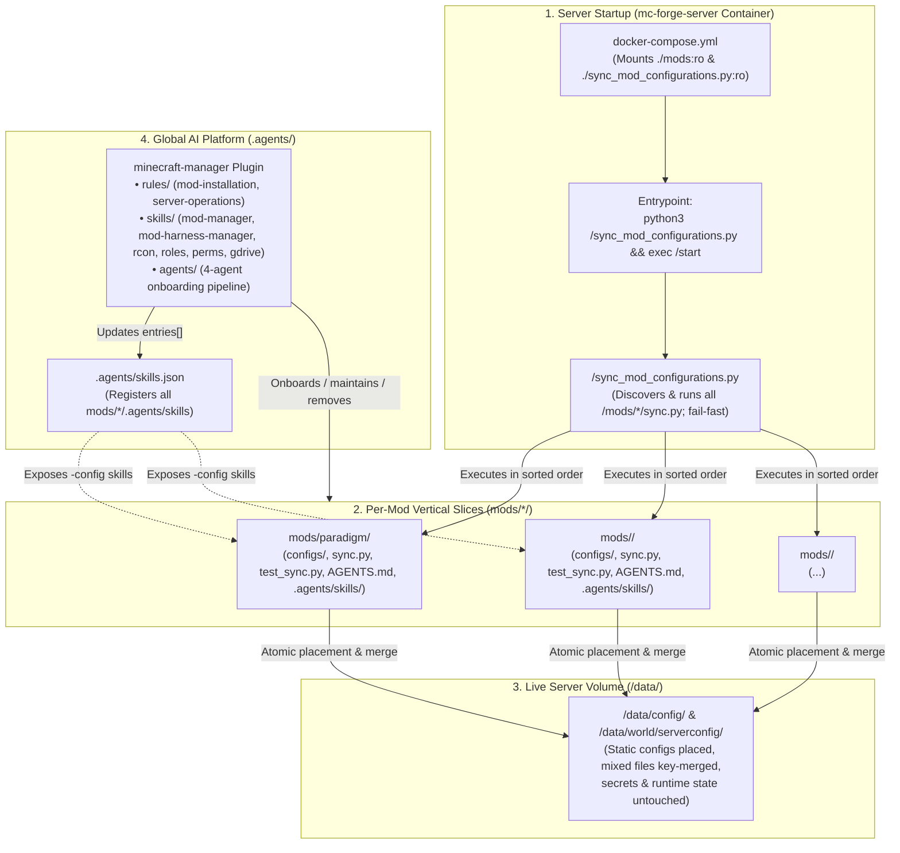

# Technical Design Document: Global Multi-Mod Configuration & AI Harness Architecture

> **Companion To:**
> - [mod_harness_architecture.md](./mod_harness_architecture.md) *(Per-Mod Vertical Slice Specification)*
>
> **Scope:** Repository-wide configuration synchronization (`docker-compose.yml` $\rightarrow$ `/sync_mod_configurations.py` $\rightarrow$ `mods/*/sync.py`), global skill discovery (`.agents/skills.json`), core plugin rules/skills (`.agents/plugins/minecraft-manager/`), and the four-agent mod onboarding pipeline.  
> **Status:** Implemented & Verified (v10)

---

## 1. Global Architectural Principles

1. **Container-Startup-Only Synchronization (`mc-forge-server`):**
   - Configuration placement from `mods/*/configs/` into `/data/` runs **automatically and exclusively** when the `mc-forge-server` Docker container starts (`python3 /sync_mod_configurations.py && exec /start`).
   - There is **no** manual `make config-push` / `config-pull` workflow, and **no** skill or `AGENTS.md` instructs agents to sync `data/` with the repo on config changes.
2. **One-Way Source of Truth (`mods/<slug>/configs/` $\rightarrow$ `data/`):**
   - Static configuration is edited only in `mods/<slug>/configs/`. Live runtime state (player UUIDs, world coordinates, databases) and secrets remain exclusively in `data/`.
   - Core `server.properties` keys are managed via environment variables in [docker-compose.yml](file:///home/wakaria/dev/minecraft-server/docker-compose.yml) / `.env` (per [minecraft-server-operations.md](file:///home/wakaria/dev/minecraft-server/.agents/plugins/minecraft-manager/rules/minecraft-server-operations.md)).
3. **Decoupled Per-Mod Slices (`mods/*/`):**
   - Each onboarded mod owns its own independent vertical slice (`configs/`, `sync.py`, `test_sync.py`, `AGENTS.md`, and `.agents/skills/<slug>-config/SKILL.md`), defined in [mod_harness_architecture.md](file:///home/wakaria/dev/minecraft-server/docs/dev/mod_harness_architecture.md).
4. **Direct Skill Discovery (No Central Config Router):**
   - Every mod's `.agents/skills` folder is registered directly in root [`.agents/skills.json`](file:///home/wakaria/dev/minecraft-server/.agents/skills.json), eliminating the need for a central `minecraft-config-manager` router skill.

---

## 2. Global System Topology



---

## 3. Global Repository Structure

```text
/home/wakaria/dev/minecraft-server/
├── docker-compose.yml                           # Mounts ./mods & /sync_mod_configurations.py; runs sync on boot
├── sync_mod_configurations.py                   # Global runner executing all mods/*/sync.py (--dry-run, --mod)
├── test_sync_mod_configurations.py              # Global runner test suite (4 tests)
├── Makefile                                     # Server lifecycle targets (up, down, restart, logs, sync, backup)
├── .agents/
│   ├── skills.json                              # Root manifest registering all mods/<slug>/.agents/skills
│   └── plugins/
│       └── minecraft-manager/
│           ├── plugin.json
│           ├── agents/                          # Mod-agnostic 4-agent onboarding pipeline
│           │   ├── minecraft-mod-harness-manager/
│           │   │   └── agent.md                 # Coordinator & Researcher
│           │   ├── mod-bridge-engineer/
│           │   │   └── agent.md                 # Stage 1: Non-AI Bridge (configs/, sync.py, test_sync.py)
│           │   ├── mod-harness-architect/
│           │   │   └── agent.md                 # Stage 2: AI Harness (AGENTS.md, SKILL.md, skills.json)
│           │   └── mod-harness-reviewer/
│           │       └── agent.md                 # Stage 3: End-to-End Auditor
│           ├── rules/
│           │   ├── minecraft-mod-installation.md
│           │   └── minecraft-server-operations.md
│           └── skills/
│               ├── minecraft-gdrive-sync/
│               ├── minecraft-mod-harness-manager/
│               │   ├── SKILL.md                 # Onboarding, sync.py maintenance, & removal runbook
│               │   └── scripts/
│               │       └── remove_mod_harness.py
│               ├── minecraft-mod-manager/
│               ├── minecraft-permission-manager/
│               ├── minecraft-rcon/
│               └── minecraft-role-manager/
├── mods/                                        # Per-mod vertical slices (see mod_harness_architecture.md)
│   └── paradigm/                                # Reference slice
├── modpack/                                     # Mod .jar binaries (gitignored, synced to Google Drive)
└── data/                                        # Live Docker runtime volume (gitignored)
```

---

## 4. Global Lifecycle: Install, Onboard, Maintain & Remove

### 4.1 Global Startup Runner (`/sync_mod_configurations.py`)
- Discovers all `mods/*/sync.py` scripts in sorted order (or a single slice with `--mod <slug>`).
- Executes each script with `sys.executable` and fails fast on the first non-zero exit code—preventing `mc-forge-server` from booting with broken invariants or leaked secrets.
- Verified inside `itzg/minecraft-server:latest` (which includes Python 3.12.3 and `/start` $\rightarrow$ `exec /image/scripts/start`).

### 4.2 Mod Onboarding & Removal Pipeline (`minecraft-mod-harness-manager`)
1. **Install Mod (`minecraft-mod-manager`):** Downloads `.jar` into `modpack/`, syncs to `data/mods/`, and boots `mc-forge-server` so the mod generates its default configs in `data/`.
2. **Onboard Slice (`minecraft-mod-harness-manager`):**
   - Registers and invokes the `minecraft-mod-harness-manager` coordinator subagent via `define_subagent` / `invoke_subagent`.
   - **Stage 1 (`mod-bridge-engineer`):** Classifies `data/` files, seeds `mods/<slug>/configs/`, writes `mods/<slug>/sync.py` (with self-explanatory invariant errors and atomic `os.replace()` + `os.chown()`), and writes `mods/<slug>/test_sync.py`.
   - **Stage 2 (`mod-harness-architect`):** Authors `mods/<slug>/AGENTS.md` (at mod root), `mods/<slug>/.agents/skills/<slug>-config/SKILL.md` (pure mod domain guide), and registers `{"path": "mods/<slug>/.agents/skills"}` in `.agents/skills.json`.
   - **Stage 3 (`mod-harness-reviewer`):** Runs `test_sync.py` and `sync.py --dry-run` / `sync.py` idempotency checks, and audits both layers.
3. **Maintain Slice:** Whenever `mods/<slug>/configs/` changes structurally (new files, new runtime/static keys, new invariants), `mods/<slug>/sync.py` and `mods/<slug>/test_sync.py` are updated and verified together.
4. **Remove Slice:** `remove_mod_harness.py <slug>` unregisters the skill from `.agents/skills.json` and deletes `mods/<slug>/`.
