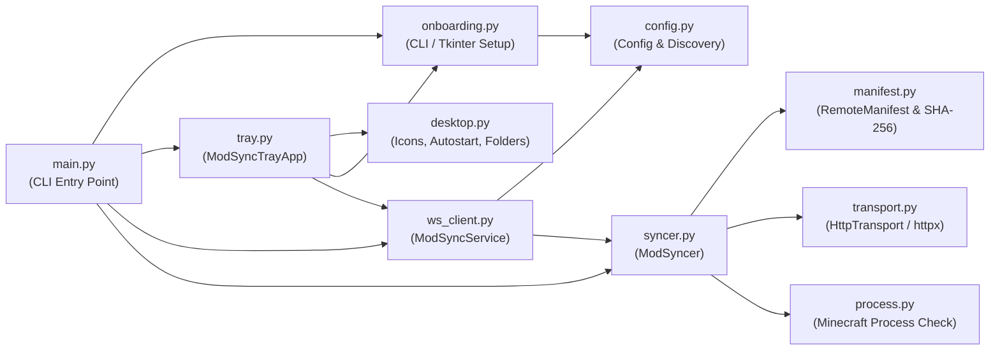
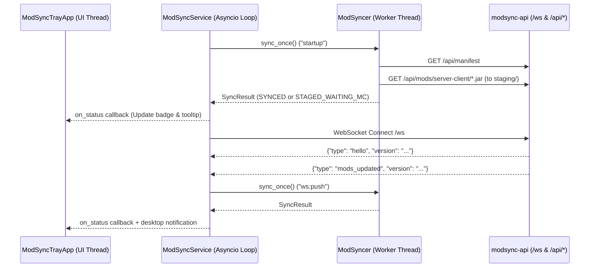

# 🔄 ModSync Client Architecture & Developer Guide (`client/`)

> **Companion To:**
> - [[index|Minecraft Survival Server Guide]]
> - [[mod_harness_architecture|Per-Mod Harness & Bridge Architecture]]
>
> **Scope:** Module architecture, synchronization lifecycle, safe staging invariants, system tray UI, and PyInstaller build pipeline for the standalone `modsync-client` Python application under `client/`.

---

## 1. Overview

**ModSync Client** (`client/`) is a cross-platform background synchronizer and system tray application that keeps a player's local Minecraft `mods/` directory synchronized with `modsync-api` over HTTPS and WebSocket (`wss://`).

### Key Capabilities
- **Real-Time Push Updates:** Maintains a persistent WebSocket connection (`/ws`) to receive instant `mods_updated` broadcasts when mandatory server mods change, paired with a periodic HTTP fallback poll.
- **Category-Aware Syncing:**
  - **`server-client` (Mandatory):** Automatically added, updated, and pruned on startup, WebSocket push, or manual sync.
  - **`client-only` (Recommended Optional):** Installed or upgraded only on explicit user request (`Install Recommended Client Mods` or `--install-recommended`) and preserved across mandatory syncs.
- **Zero-Corruption Staging:** Downloads all `.jar` files into a separate `staging/` directory, verifies SHA-256 digests before touching `mods/`, and defers live file replacement whenever a running Minecraft Java process is detected.
- **System Tray UI & Headless CLI:** Runs quietly in the OS system tray via `pystray` and `Pillow` (with native `tkinter` first-run setup dialogs), or headlessly in terminal/CI environments (`--headless`, `--sync-once`).

---

## 2. Project Layout

`client/` uses a standard Python `src/` package layout managed with `uv`, `setuptools`, `pytest`, and `PyInstaller`:

```text
client/
├── pyproject.toml                     # Package metadata, dependencies, CLI script (`modsync`), pytest config
├── uv.lock                            # Locked dependency graph for reproducible environments
├── modsync.spec                       # PyInstaller single-file build specification (`Analysis` -> `PYZ` -> `EXE`)
├── README.md                          # Quick-start instructions for players and developers
├── src/
│   └── modsync_client/
│       ├── __init__.py                # Package version metadata
│       ├── main.py                    # Thin CLI entry point (`build_parser`, `_run_one_shot`, `_run_headless`, `main`)
│       ├── config.py                  # Frozen `Config` dataclass, OS paths, launcher discovery, `build_ws_url`
│       ├── onboarding.py              # CLI & Tkinter GUI setup prompts and config resolution precedence
│       ├── manifest.py                # `RemoteMod`, `RemoteManifest`, regex validation, `compute_sha256`, `parse_manifest`
│       ├── transport.py               # `HttpTransport` protocol and production `HttpxTransport` client
│       ├── process.py                 # `psutil`-backed Minecraft Java client process detection
│       ├── syncer.py                  # `ModSyncer`, `SyncStatus`, `SyncResult`, diffing, staging, atomic promotion
│       ├── ws_client.py               # `ModSyncService` async WebSocket listener, backoff, and fallback poll/stage loop
│       ├── desktop.py                 # Badge icon renderer (`make_badge_icon`), Windows autostart, OS folder opener
│       └── tray.py                    # `ModSyncTrayApp` system tray controller and menu wiring
└── tests/
    ├── conftest.py                    # Shared pytest fixtures (`mods_dir`, `staging_dir`)
    ├── test_config.py                 # Unit tests for `Config`, WebSocket URL construction, and CLI/env resolution
    └── test_syncer.py                 # Unit tests for manifest validation, diff/prune, staging, and category isolation
```

---

## 3. Module Architecture & Responsibilities



### 3.1 Configuration & Onboarding (`config.py`, `onboarding.py`)
- **`Config` (`config.py`):** Immutable `@dataclass(frozen=True)` storing `server_url`, `mods_dir`, `client_token`, and `poll_fallback_seconds` (default `300s`). Persisted atomically to disk via a `.tmp` file + `os.replace()`.
  - **Windows:** `%APPDATA%\ModSync\config.json` (staging in `%APPDATA%\ModSync\staging\`)
  - **macOS:** `~/Library/Application Support/ModSync/config.json`
  - **Linux:** `${XDG_CONFIG_HOME:-~/.config}/modsync/config.json`
- **Launcher Discovery (`detect_mods_dirs`):** Automatically scans standard installation roots for **Modrinth App**, **Prism Launcher**, **MultiMC**, **CurseForge**, and vanilla `.minecraft/mods` on Windows and Linux/Flatpak to pre-populate the first-run folder picker.
- **Configuration Resolution Order (`resolve_or_setup_config` in `onboarding.py`):**
  1. Explicit `--setup` flag (forces interactive Tkinter GUI or CLI setup).
  2. Both `--server-url` and `--mods-dir` passed on the CLI.
  3. Existing `config.json` on disk (merged with any single CLI override such as `--server-url`, `--mods-dir`, or `--token`).
  4. Environment variables (`MODSYNC_SERVER_URL`, `MODSYNC_MODS_DIR`, `MODSYNC_CLIENT_TOKEN`).
  5. Interactive onboarding prompt (Tkinter GUI dialog in desktop mode; terminal prompt in `--headless` / `--sync-once` TTY mode).

### 3.2 Manifest Validation & HTTP Transport (`manifest.py`, `transport.py`)
- **`manifest.py`:** Parses and validates the `/api/manifest` JSON payload into immutable `RemoteManifest` and `RemoteMod` instances:
  - Enforces `SAFE_JAR_NAME_RE` (`^[A-Za-z0-9._+-]+\.jar$`) to prevent path traversal or non-jar writes.
  - Enforces lowercase 64-character hex SHA-256 digests (`^[0-9a-f]{64}$`).
- **`transport.py`:** Decouples network I/O behind the `HttpTransport` `Protocol` (`get_json`, `download_to`). Production code uses `HttpxTransport` (streaming 64 KiB chunks with optional `Authorization: Bearer <client_token>`), while unit tests inject an in-memory `FakeTransport`.

### 3.3 Core Synchronizer & Safe Staging (`syncer.py`, `process.py`)
- **`ModSyncer` (`syncer.py`):**
  - Maintains an in-memory `(st_size, st_mtime_ns) -> sha256` cache (`_hash_cache`) so unchanged local `.jar` files are not re-hashed on every check.
  - Computes a 3-way diff (`to_add`, `to_update`, `to_remove`) for the target category (`server-client` or `client-only`) while protecting any `.jar` listed in either manifest category from accidental pruning.
  - Downloads new/updated `.jar` files to `staging/.<filename>.part`, verifies the SHA-256 digest against the manifest, and atomically renames to `staging/<filename>`.
- **Minecraft Process Guard (`process.py`):**
  - Scans active processes via `psutil` for `java` executables whose command line contains Minecraft/launcher markers (`net.minecraft`, `cpw.mods.bootstraplauncher`, `net.minecraftforge`, `modrinth`, `prismlauncher`).

> [!important] Safe Staging While Minecraft Is Running
> On Windows, open `.jar` files are locked by the JVM process, and mutating `mods/` mid-session can corrupt or crash the client. Whenever `default_is_minecraft_running()` returns `True`, `ModSyncer` downloads and verifies all updates in `staging/`, records `_pending_sync`, and transitions to `SyncStatus.STAGED_WAITING_MC` (**Amber** tray icon). As soon as the background loop detects that Minecraft has exited, `try_apply_staged()` atomically promotes the staged `.jar` files into `mods/`.

### 3.4 Background Service & WebSocket Loop (`ws_client.py`)
`ModSyncService` runs two concurrent asyncio loops after performing an initial `"startup"` sync:
1. **`_ws_loop()`:** Connects to `ws(s)://<host>/ws` with exponential backoff (`2.0s` $\rightarrow$ `60.0s` + random jitter).
   - On `hello`: triggers a sync if the server's `version` differs from `_last_result.version`.
   - On `mods_updated`: immediately triggers a mandatory `"ws:push"` sync.
   - On `ping`: replies with `"pong"`.
2. **`_poll_and_stage_loop()`:** Wakes every `5.0s` (or immediately on thread-safe `request_sync()`, `request_install_recommended()`, or `stop()` events) to:
   - Execute manual sync or recommended client-mod install requests from the system tray thread.
   - Call `syncer.try_apply_staged()` when status is `STAGED_WAITING_MC`.
   - Trigger a fallback HTTP poll every `poll_fallback_seconds` (minimum `30s`, default `300s`).



### 3.5 Desktop Integration & System Tray UI (`desktop.py`, `tray.py`)
- **`desktop.py`:**
  - Dynamically renders a 64×64 rounded-square badge icon (`make_badge_icon`) colored by `SyncStatus`:
    - **Idle (`#6b7280` — Gray):** Starting up
    - **Syncing (`#3b82f6` — Blue):** Checking manifest / downloading mods
    - **Synced (`#22c55e` — Green):** Up to date and connected
    - **Staged Waiting for MC (`#f59e0b` — Amber):** Updates staged in cache; waiting for Minecraft to close
    - **Error (`#ef4444` — Red):** Server unreachable or verification error
  - Manages Windows startup registration (`%APPDATA%\Microsoft\Windows\Start Menu\Programs\Startup\ModSync.bat`) and cross-platform folder opening (`os.startfile`, `open`, `xdg-open`).
- **`tray.py` (`ModSyncTrayApp`):**
  - Runs the `pystray.Icon` loop on the main thread while running `ModSyncService.run()` on a daemon background thread (`modsync-bg`), communicating exclusively via thread-safe `call_soon_threadsafe` event triggers.

---

## 4. Development, Testing & Packaging

### 4.1 Local Development & CLI Usage
```bash
# Install runtime + dev dependencies into client/.venv
uv --directory client sync --group dev

# Run in headless daemon mode
uv --directory client run modsync --headless --server-url https://mods.example.com --mods-dir /path/to/mods

# Run a one-shot mandatory sync and exit
uv --directory client run modsync --sync-once

# Install optional recommended client-only mods and exit
uv --directory client run modsync --install-recommended
```

### 4.2 Running Unit Tests
```bash
uv --directory client run pytest -v
```
*(Or run `make test` from the repository root to execute server, `modsync_api`, and `client` test suites together.)*

### 4.3 Building Standalone Executables (`PyInstaller`)
[modsync.spec](file:///home/wakaria/dev/minecraft-server/client/modsync.spec) bundles the Python interpreter, `modsync_client`, and OS-specific `pystray`/`Pillow` backends into a single executable (`client/dist/ModSync` on Linux or `client/dist/ModSync.exe` on Windows):

```bash
make client-build
# Equivalent to:
# cd client && uv sync --group dev && uv run pyinstaller modsync.spec --clean --noconfirm
```

> [!tip] Automated Cross-Platform Releases
> Pushing a git tag matching `client-v*` triggers `.github/workflows/release-client.yml`, which runs `pytest` and builds both `ModSync.exe` (`windows-latest`) and `ModSync-linux` (`ubuntu-latest`) via PyInstaller and publishes them to GitHub Releases.
